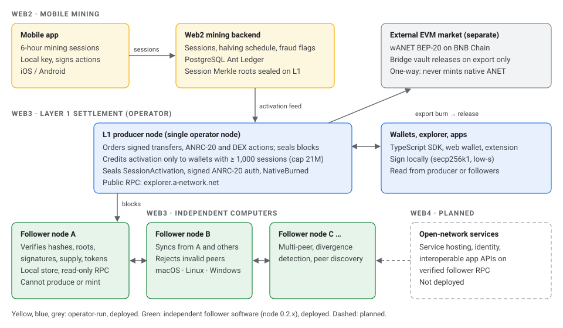

# A-Network Official Whitepaper v4.7 — ANRC-20 and Open Network Infrastructure

> Markdown rendition of the published `whitepaper.html` (November 13, 2026).

Decentralization Milestone · May 24, 2026

The ANET BEP-20 contract on BNB Chain has had its ownership **permanently renounced**. The `owner` slot is now `0x0000000000000000000000000000000000000000` and cannot be changed. The functions `mint()`, `pause()`, `unpause()`, and `setBlacklist()` are **permanently disabled**. Maximum supply is locked at **21,000,000 ANET** forever. The contract now obeys only its code, equally for every holder.

**Contract:** `0x791055A7d52AA392eaE8De04250497f33807E46A`  
**Verify:** [BscScan → Read Contract → `owner()`](https://bscscan.com/token/0x791055A7d52AA392eaE8De04250497f33807E46A#readContract) → returns `0x0000…0000`.  
**Co-founder stewardship (50% / 50%):** [@Joel\_Dupalco](https://x.com/Joel_Dupalco) · [@Digitalgold1979](https://x.com/Digitalgold1979). Stewards hold tokens as ordinary holders with **no** on-chain administrative privileges.

Scope note: this milestone decentralizes the BNB Chain (Layer 2) token contract. As of **May 25, 2026** the bridge itself has also been decentralized: releases now require a 2-of-3 EIP-712 signature threshold from independent self-hosted signers against the **AnetBridgeVault** contract (`0x31438362a7667ce5559500023D025c7c14168B49`). The A-Network Layer 1 chain and cash-out escrow remain operator-run today and are scheduled for phased decentralization on the v3.x roadmap.

Decentralization Status Tracker · Updated May 28, 2026

A-Network is on a **phased decentralization roadmap**. This scorecard documents exactly which components are currently trustless versus operator-run. We publish it so the community can hold the project accountable, in line with the Bitcoin principle: *"don't trust, verify."*

| # | Milestone | Status | What it means |
| --- | --- | --- | --- |
| 1 | **ANET BEP-20 ownership renounced** | Done May 24, 2026 | Token contract on BNB Chain is immutable. Nobody, including founders, can mint, pause, or blacklist. [Verify on BscScan](https://bscscan.com/token/0x791055A7d52AA392eaE8De04250497f33807E46A#readContract). |
| 2 | **Bridge escrow → on-chain multi-signer vault** | Done May 25, 2026 | The wANET escrow was migrated from a hot EOA to **AnetBridgeVault**, a custom one-way-sink contract that is stricter than a Gnosis Safe: admin cannot rescue the vault asset, all releases require an EIP-712 signature threshold, and the bridge submitter wallet has zero signing authority. [View on BscScan](https://bscscan.com/address/0x31438362a7667ce5559500023D025c7c14168B49). |
| 3 | **Deploy AnetBridgeVault with 2-of-3 EIP-712 signatures** | Done May 25, 2026 · deploy tx 0x82da7f2a…62c7e | Smart-contract bridge replaces the custodial relayer. On-chain caps (10k / 50k / 250k ANET per tx / per-recipient-24h / global-24h), on-chain burn-ID dedup, EIP-712 2-of-3 multi-signer release. Signatures are collected on L1 via `POST /bridge/burns/:id/sigs` from three independent self-hosted signer daemons; the relayer holds no signing keys and can only submit gas. [Source](contracts/src/AnetBridgeVault.sol) · [Internal audit](contracts/AUDIT_BRIDGE_2026-05-24.md). |
| 4 | **Founder treasury custody → vault (50% deposited)** | Done May 25, 2026 | The [@Joel\_Dupalco](https://x.com/Joel_Dupalco) 50% founder allocation (**10,499,798.020348 wANET**) was moved from a hot EOA (`0xB65B30…6184F`) into **AnetBridgeVault**. wANET held by the founder is now custodied by the 2-of-3 EIP-712 multisig: no single signer (including the founder himself) can release the funds. Vault total post-deposit: **~10.5M wANET**. The [@Digitalgold1979](https://x.com/Digitalgold1979) mirror 50% deposit is the next milestone. [Verify vault balance on BscScan](https://bscscan.com/address/0x31438362a7667ce5559500023D025c7c14168B49). |
| 5 | **48-hour timelock on vault admin actions** | Done May 25, 2026 | Shipped as part of the May 25 AnetBridgeVault deploy. Every admin parameter change (fee bps, fee recipient, signer-set rotation, threshold change, pauser/operator rotation, unpause) goes through `scheduleChange` → **48-hour** wait → `executeChange`, with a 14-day grace window and bait-and-switch-resistant arg re-hashing. Cancellable via `cancelChange(id)`. Source: `TIMELOCK_DELAY = 48 hours` in [AnetBridgeVault.sol](contracts/src/AnetBridgeVault.sol). |
| 6 | **AnetSwap ownership → multisig + timelock** | In progress Code shipped May 28, 2026 · awaiting v3.6 deploy | Contract code complete in v3.6: 48h timelock on every parameter change, 3-role split (`admin` / `pauser` / `operator`), 2-step admin handover, withdrawals admin-only with destination hard-wired to `admin` so a compromised owner key cannot redirect. See [v3.6 changelog](#v36-changelog). Full deploy runbook published at <contracts/DEPLOY_V36_MIGRATION.md>. **Pending:** fresh BSC deploy with Safe multisig as `admin` + bridge-state migration off the v3.5 contract at `0x1A1AFE5BF1ffDB64aC10958cCe2D06B22Fb47Fb8`. Renounce remains a separate downstream milestone (analogous to #10). |
| 7 | **Public peer-review program** | In progress Recognition program open May 28, 2026 | A-Network has neither cash budget for a paid audit firm (USD 15–60k at this scope) nor a discretionary wANET pool to offer as bounty; the founder allocation is reserved for its published economic functions and we will not dilute that commitment. Instead we publish the [full audit package](contracts/AUDIT_PACKAGE.md) (1,170 LOC, frozen commit SHA, source hashes, reproducible build, full threat model) and offer external researchers **durable public recognition**: credit in the fix commit, credit in the whitepaper changelog, an entry in `SECURITY_FINDINGS.md`, a pinned project-account acknowledgement for Critical / High findings, and a signed letter of acknowledgement for portfolios. Rules and severity table in <SECURITY.md>. This is the honest stance: a zero-budget project should not pretend to fund what it cannot fund. Milestone flips to ✅ DONE when at least one external researcher publishes a finding (or a documented zero-finding clean review) against the frozen commit. |
| 8 | **L1 multi-validator set (3+ independent operators)** | In progress Recruitment spec published May 28, 2026 | Public recruitment + technical spec at [anet-chain/VALIDATOR\_RECRUITMENT\_SPEC.md](https://github.com/A-Network-2026/anet-chain/blob/main/VALIDATOR_RECRUITMENT_SPEC.md). Phase 2 target = 3 independent operators on 2-of-3 quorum (closes the scorecard but is honestly not yet BFT). **Phase 2 is volunteer:** no monetary compensation, no wANET grants, no infra reimbursement. A-Network is a zero-budget project and the founder allocation is reserved for its published economic functions. Phase 2 operators receive public attribution, governance voice, and priority eligibility for Phase 3 protocol-level block rewards when they ship. Phase 3 (4 validators, 3-of-4) is the first BFT-capable configuration and the next planned milestone after #8. **Pending:** two external operators completing onboarding (§6 of the spec). |
| 9 | **Open-source bridge relayer & L1 node** | In progress License + governance landed May 28, 2026 | All three repositories are MIT-licensed (OSI-approved): `A-Network-2026/LICENSE`, `A-Network-2026/pi-backend/LICENSE`, `anet-chain/LICENSE`. Public contribution surface landed: `SECURITY.md` + `CONTRIBUTING.md` on both A-Network-2026 and anet-chain, with coordinated-disclosure timelines, safe-harbor language, and per-component scope. **Pending:** publishing signed release-tag binaries of `anet-chain` and `pi-backend` on GitHub Releases with SHA-256 sums so non-builders can verify what they run. |
| 10 | **Renounce vault admin role** | PLANNED | After 6+ months of clean bridge operation under multisig, the admin role on AnetBridgeVault is renounced. Bridge becomes fully Model-2 (smart-contract, trustless). |
| 11 | **AnetSwap hardening pass (v3.5 audit)** | Done May 28, 2026 | Internal “Satoshi & Engineer Thanks” audit applied: Safe-multisig–compatible fee/withdraw via `.call{value:}`, paginated `getPendingSwapsPaged()` view, withdrawal & fee-forward events, graceful fee-forward fallback. See [v3.5 changelog](#v35-changelog). |

**Current honest classification:** the **ANET BEP-20 token contract is ownerless**, while the bridge release path remains controlled by its disclosed 2-of-3 signer policy, on-chain caps, and burn-ID dedup. These controls reduce single-key risk but do not make the whole system trustless. The **L1 chain, cash-out escrow, reserve operations, and off-chain services remain operator-run today**. A-Network does not claim system-wide decentralization until the stated milestones are complete and externally verified.

Canonical supply invariant (v4.4): native L1 ANET is created **only** by the mining/activation schedule (hard cap 21,000,000) and can only *decrease* via bridge-out burns; no deposit, purchase, or external burn mints native ANET. The BEP-20 market token (`0x791055…E46A`, fixed 21,000,000 supply, pre-minted at token genesis) is a **separate external market asset**: it is released from the bridge vault against verified L1 burns, but holding or buying it confers **no redemption right** into native L1 ANET. The two 21M caps are parallel accounting domains, not one fungible pool. For the portal-generation wANET (mint-on-lock), Σ wANETportal ≤ ANET burned via portal locks.

Technical Paper v4.7 (ANRC-20 and Open Network Infrastructure)

# A-Network Technical Whitepaper

A-Network operates a native Layer 1 settlement ledger and a separate EVM market. Version 3.9 defines the controls required before public Layer 1 liquidity can be described as real: every pool contribution must debit a named wallet, the paired reserve asset must be registered and externally verifiable, bootstrap or administrator-created balances cannot be presented as liquidity, and the mobile interface must fail closed when any audit gate is missing. The designated EVM reserve treasury is `0x9C7C1058fdc9b710f688ECb7562924D9AE771417`. A Bitcoin reserve may support a separately identified ANET/BTC market only after a Bitcoin treasury address and proof transaction are published. Bitcoin reserves, EVM reserves, and native Layer 1 balances are never merged in accounting or represented as interchangeable custody. Layer 1 currently uses fixed protocol operations and has no general-purpose smart-contract virtual machine; any future VM requires a separately specified consensus upgrade, public test environment, independent audit, and explicit activation decision.

**Version**: 4.7 (ANRC-20 and Open Network Infrastructure)

**Published**: November 13, 2026

**Layer 1 Economy**: Closed-loop · Utility-driven · ANTS-denominated

**EVM Reserve Treasury**: `0x9C7C1058fdc9b710f688ECb7562924D9AE771417`

**Solana Treasury**: `7j33RFPkNvaKsPuz2qJ5SzwiwXA4iL12ujqM4g2tRLEz`

**Bitcoin Reserve Treasury**: `bc1qrqunzzv8dsr5dxdrlq5gcex93rh7w0tqawfhf4` (unfunded; BTC market disabled)

**Market Separation**: Native L1 · Bitcoin reserve market · EVM market accounted separately

**Denomination**: 1 ANET = 100,000,000 ANTS

**Liquidity Rule**: Wallet-funded · reserve-backed · independently auditable · never bootstrap

v4.7 Changelog · November 13, 2026

## Version 4.7: ANRC-20 and Open Network Infrastructure

Version 4.7 documents the ANRC-20 native token standard as implemented, follower-node software that lets any computer independently verify and replicate Layer 1, and the supply checks every such node performs. It changes no supply figure, issuance schedule, halving rule, eligibility threshold, vesting schedule, liquidity disclosure or bridge policy. The one-way bridge invariant of Version 4.4, the vesting schedule of Version 4.3 and the creator gate of Version 4.5 remain in force without modification.

### Status at publication

| Component | Status on November 13, 2026 |
| --- | --- |
| ANRC-20 create, mint, transfer and registry | Live on mainnet since October 22, 2026 |
| Follower node: verify, store, serve | Released in node 0.2.0 (source published); verified against the full production history before and after deployment |
| Platforms | Build and tests pass on Linux, macOS and Windows (CI) |
| Signed ANRC-20 authorizations sealed in blocks | Live since November 13, 2026, 17:27 UTC (node 0.2.0) |
| `NativeBurned` export records, full-digest document attestation | Live since node 0.2.0 |
| Activation credits the Web2 ledger balance (owner decision) | Live since November 13, 2026, 17:41 UTC (node 0.2.1) |
| TypeScript SDK 0.1.0 | Source published with the node (not yet on npm); signatures byte-identical with the node |
| Multi-validator block production | Not implemented |
| Web4 open-network services | Planned; not deployed |

### A. ANRC-20 native token standard

ANRC-20 is a fixed-function token module in the Layer 1 node, consistent with § SC. It is not a smart-contract standard: there is no virtual machine, no user-deployed code, and no EVM or TRON compatibility.

- **Identity.** A unique, immutable symbol (1–16 of A–Z, 0–9, `_`, `-`; `ANET` and `WANET` reserved) is the canonical identifier. Name (1–64 characters), decimals (0–18), owner and the mintable flag are fixed at creation. Supply is an unsigned 64-bit integer and always equals the sum of balances.
- **Lifecycle.** Create (wallet with at least 1,000 completed sessions, not a bootstrap seat; initial supply to the creator), mint (owner only, mintable tokens only), transfer (holder). There is no burn and no administrative override. Supply grows only through create and mint.
- **Transaction rules.** Each operation carries a signed authorization over `action-v1|action|wallet|nonce|timestamp|chain_id|canonical payload` with a low-s secp256k1 signature. The node rejects a different chain, a payload that differs from the request, and a nonce that is not strictly greater than the previous one for that wallet and action.
- **Fees.** ANRC-20 operations carry no fee. Any future fee requires a specified, versioned protocol rule (Version 4.5).
- **Separation from native ANET.** Token balances are recorded separately from ANET. No token operation creates, destroys or moves native ANET, and every follower node checks this independently (part C).
- **On-chain record** *(live since node 0.2.0)*. Each operation is sealed as a `TokenTransferred` event that includes the full signed authorization. Followers re-verify the signer, payload and nonce of every token operation from the first sealed authorization onward. The three tokens created on October 22, 2026 (`CJ`, `CJC`, `DG`) predate sealing. Their supply and balances are verified, but their signatures were not recorded on-chain.

### B. Mobile mining and genesis integrity

- **Canonical chain.** Chain ID `anet-private-mainnet-1`; block 0 hash `24f8723fe1ea0b186d28b5574979fdd91236328e6c1c733ae93989389bb9d49b`, sealed April 21, 2026. The genesis block is preserved. Mining sessions do not create blocks or genesis blocks; blocks are produced only when there is pending work.
- **Revelation Block 0.** The signed snapshot of May 26, 2026 (SHA-256 `f8719ae3…d27a`, 81,763 wallets, 31,990.69 ANET) attests to the Web2 mining ledger. It is not Layer 1 block 0 and credits nothing on Layer 1.
- **From mining to Layer 1.** Sessions are recorded by the Web2 backend. Once a wallet reaches 1,000 completed sessions, the producer credits its activation and seals a `SessionActivation` receipt together with `activated_supply_ants`. Session counts of all miners are committed as Merkle roots (34,986 roots sealed so far).
- **Reconciliation (verified).** On November 13, 2026 an independent follower replayed every block. Its account balances total 239.59021715 ANET, exactly equal to the supply reported by the producer at the same height (39,601). No native ANET has yet entered Layer 1 through mining activation: 0 wallets are eligible, and the highest session count recorded in on-chain milestones is 739.

#### Protocol decision (owner, November 13, 2026)

Activation credits each newly eligible wallet its Web2 ledger balance, which follows the halving schedule of Section 7. The previous rule, `max(stored balance, sessions × 4,882,812 ANTS)`, re-priced every session at the launch-era rate; on a local test network a wallet that earned 2.62 ANET for 1,000 sessions was activated with 48.83 ANET. No wallet had been activated, so no balance changed. The rule is published as `activation_credit` in `/network/consensus` and has been live since node 0.2.1 (November 13, 2026, 17:41 UTC).

### C. Native ANET supply protection

- **Unchanged rules.** 21,000,000 ANET maximum; 1 ANET = 100,000,000 ANTS; native ANET originates only from the mining and activation schedule; no premine, development, validator or computer allocation exists; no administrative mint route exists; wANET and native ANET remain separate, and purchased wANET never becomes native ANET.
- **Computers cannot create ANET.** Follower software has no block-production or credit path. Every follower rejects a block that pushes native ANET above the cap or that, after the issuance checkpoint, increases native ANET by more than its sealed activation credits. Native ANET is counted as account balances plus DEX pool reserves plus WANET. Exports and clawbacks are added back before the comparison, so a mint cannot hide behind a burn. Credits must go to eligible wallets and may not exceed 4,882,812 ANTS per session.
- **Issuance checkpoint.** Block position 4,777 (hash `26d0863f…5ae7`, June 28, 2026) closes the legacy era. Native ANET that entered Layer 1 before it, without an activation receipt, is itemized below. All ~34,800 later blocks pass the strict rule.

| Block position | Origin | ANET |
| --- | --- | --- |
| 169, 1809, 1813, 1816 | EVM bridge credits before the one-way policy (purchases), including fees | 241.89019714 |
| 44 | Operator bootstrap reserve in the `ANET-USDC` pool (no wallet debit; excluded from markets by the Version 3.9 pool audit) | 10.00000000 |
| 1, 10 | Integration-test transfer and Pi settlement | 0.00002001 |
| **Total native ANET on Layer 1 (accounts 239.59021715 + pool reserves 11.30 + WANET 1.00)** | | **251.89021715** |

### D. Computer node infrastructure

| Node | Operated by | Role |
| --- | --- | --- |
| Producer | A-Network operator (one node) | Orders operations, seals blocks, credits activation from the Web2 ledger |
| Follower | Anyone | Downloads, verifies, stores and serves the chain; produces no blocks; cannot mint |
| Verifier | Anyone | One-shot audit of a peer's history and ledger |
| Validator seat | Wallets with ≥ 1,000 sessions (top 2,100) | Receives a share of transaction fees; does not sign or vote on blocks |

- **Synchronization.** A follower downloads blocks in pages of 256 from one or more peers (the producer or other followers). For each block it checks the hash, the commitment roots, the link to the previous block, every transaction signature and the ledger rules of parts A and C. It then stores the block in an embedded database. On restart it re-verifies the local store and resumes. Corrupted data is dropped and re-downloaded.
- **Peers.** Each node classifies its peers as in sync, behind, ahead, divergent, incompatible, unreachable or rejected, and syncs from the furthest-ahead peer whose data verifies. Peers are discovered through `/network/seeds`.
- **Platforms and requirements.** macOS, Linux and Windows; Rust 1.88; about 200 MB of disk for mainnet; no database. The follower serves a read-only API: health, head, blocks, node status, accounts and tokens.
- **Independent vs operator-controlled.** Verification and replication are independent: any computer reaches the same verdict without trusting the operator. Block production, ordering, the activation feed and the public RPC remain operator-controlled.

Production architecture, release 0.2.0.

### E. Web2 → Web3 → Web4

- **Web2: mobile mining.** The app, six-hour sessions, mining records and fraud controls (Sections 6–8).
- **Web3: blockchain and token infrastructure.** The native Layer 1, ANRC-20, wallets, developer interfaces and independent follower nodes, together with the separately accounted EVM market.
- **Web4: A-Network open network (planned).** Distributed services, identity integrations, interoperable application interfaces, network discovery and independent service hosting, built on verified follower APIs. These are proposed capabilities: none is deployed, and none introduces a new consensus mechanism or native supply.

*Terminology.* This version adopts the three-stage framing above. Earlier versions use *Web4* for the live Layer 1 (Section 10) and *Web3* for the BNB Chain integration (Section 9), as in the comparison of Section 4. Those titles will be aligned in a later editorial revision. The ANET Core (Web5) material of Section 11 is preserved without modification.

### F. ANRC-20 developer documentation

- **API.** `GET /tokens/anrc20`, `GET /tokens/anrc20/{symbol}`, `POST /tokens/anrc20/create`, `/mint`, `/transfer`; native `POST /transactions` with `next_nonce` from `/accounts/{address}/activity`; chain status `/sync/head`, `/health`. Errors are reported as HTTP 400 (rule), 401 (signature or payload), 409 (replayed nonce).
- **SDK.** The TypeScript SDK signs locally with the audited `@noble` libraries already used by the web wallet. A shared test vector proves that its address, action hash and signature match the node byte for byte.
- **References.** The full specification, the developer guide and the node operator guide are published with the node source (`docs/ANRC20_SPEC.md`, `docs/DEVELOPER_GUIDE.md`, `docs/NODE_OPERATOR_GUIDE.md`).

### G. Network security

- Transactions and actions use low-s secp256k1 signatures bound to the chain ID, with strictly increasing nonces. Block hashes commit every consensus field, and the state and proof roots are re-derived by every node.
- Supply, issuance and token invariants (parts A and C) are enforced by the producer and re-checked by every follower. A tampered block, and a fully re-hashed chain that mints ANET, were both rejected in testing.
- *Correction of record:* before release 0.2.0, a failed database write during a bridge export could restore the balance after the debit had already been sealed in a block. Release 0.2.0 performs the debit, the record and any rollback atomically. No such failure has occurred on mainnet.
- Dependencies: the node's Rust advisories were reduced from 14 to 0 (two unmaintained transitive crates remain).

### H. Decentralization status

| Independent today | Centralized or partially decentralized |
| --- | --- |
| Chain verification and replication by any computer; wallet key custody and signing; the ownerless BEP-20 token contract | Block production (one operator node); transaction ordering; the Web2 activation feed and mining backend; the public RPC; the 2-of-3 bridge signer set; validator seats (fee share only) |

Followers make the producer auditable, not replaceable. A multi-node test environment is not evidence of a decentralized production network. Multi-producer consensus remains unimplemented and deferred by the feature freeze.

### I. Production verification

| Check | Result |
| --- | --- |
| Node unit and integration tests (release 0.2.0) | 106 passed, 0 failed |
| SDK tests, including the cross-language signature vector | 6 passed, 0 failed |
| Full production history replayed by the follower | 39,609 blocks valid; supply reconciled exactly with the producer |
| Second implementation (independent Python) of v4 block hashes and state roots | All 37,731 v4 block hashes and their state roots reproduced |
| Local network: one producer and three followers on separate stores and ports | 20 of 20 checks in four runs (0.2.0) and 21 of 21 with the activation check (0.2.1): agreement, signed token operations, refusals, restart, failover, hostile peers |
| Post-deployment audit of production | Passed after 0.2.0 (39,615 blocks) and after 0.2.1 (39,618 blocks); the chain resumed from the same tip after each restart |
| Continuous integration | Passed for 0.2.0 and 0.2.1 on Linux, macOS and Windows, and for the SDK |
| Dependency audit | `cargo audit` 0 vulnerabilities; SDK `npm audit` 0 |

**Known limitations.** Followers verify that activation credits are sealed, eligible and within the per-session maximum. They cannot verify the underlying Web2 session records. Followers trust the operator for transaction ordering and liveness. Each deployment of the disk-backed producer has caused about six to seven minutes of RPC downtime.

### J. Roadmap

| Completed | Pending | Planned (not started) |
| --- | --- | --- |
| ANRC-20 registry; capped issuance; session commitments; one-way bridge; nodes 0.2.0 and 0.2.1 deployed; follower software, SDK and documentation published; activation rule decided | Align older section titles with the adopted framing; seal this document's SHA-256 digest on-chain (operator action) | Multi-producer consensus with validator signatures; on-chain session proofs for activation; Web4 open-network services; Web5 / ANET Core (Section 11) |

### Corrections of record

- Version 4.2 described sealing the SHA-256 digest of each published version. The node recorded only its first 16 hexadecimal characters, and no version has yet been sealed. Node 0.2.0 (live) records the full digest. Attestation of this version follows its publication.
- The node's `/network/consensus` descriptor listed TPoW proof re-verification among the verifier's checks, which the verifier did not perform. Node 0.2.0 (live) lists the checks actually performed.
- The published seed node `anet-private-mainnet.onrender.com` was 102 blocks behind the primary node on November 13, 2026, and the default seed `node1.a-network.net` does not resolve.
- Section 10 states that every miner with a completed session shares transaction fees, and Version 4.3 says validators seal transfers into blocks. In fact, blocks are sealed by the operator's producer. Fees are split among the validator seats recorded in each block (wallets with at least 1,000 sessions, top 2,100), as Version 4.5 states. Today those seats are the two operator bootstrap addresses, which have received all 10,000 ANTS (0.0001 ANET) of Layer 1 fees paid to date.

#### What did NOT change

The 21,000,000 ANET cap, the ANTS denomination, the issuance and halving schedule, six-hour sessions, the 1,000-session threshold, mined-coin vesting, every historical balance, the separation of native ANET and wANET, the one-way bridge, the liquidity and reserve disclosures, and the governance and legal-review requirements are unchanged.

v4.6 Changelog · November 1, 2026

## Version 4.6: Self-Custody Trading Terminal and Verifiable Fee Collection

Version 4.6 upgrades the public trading surface of `dex.html`, specifies exactly how the interface fee is collected on each network, and reports the live status of the export bridge. It changes no Layer 1 consensus rule, no supply figure, and no bridge policy. The one-way bridge invariant of Version 4.4 and the mined-coin vesting schedule of Version 4.3 remain in force without modification. Where this version corrects an earlier statement, the correction is marked as such.

### Trading terminal (Trade tab)

- **Layout.** The Trade tab is the default view of the DEX. It presents the external markets as an exchange terminal: a markets list, a candlestick and volume chart, a trade tape, a liquidity depth ladder, an order ticket, a balances panel, and a fees and custody panel. The chart is rendered with the open-source TradingView Lightweight Charts library (Apache-2.0), self-hosted under the site's content security policy, with the attribution the license requires.
- **Data provenance for ANET markets.** The trade tape and the candles are decoded from the `Swap` events of the PancakeSwap V2 ANET/WBNB pair on BNB Chain and valued in US dollars with the BNB price at the time of each trade. Quotes are read from the pool with `getAmountsOut`. The depth ladder is exact constant-product arithmetic on the pool reserves. Price, market capitalization, 24-hour volume and pool liquidity are read from DexScreener, as in Version 4.0.
- **Data provenance for other assets.** For BNB, ETH, BTC and SOL markets the candles and the trade tape are reference data from the Binance public market data interface, with CoinGecko as fallback, and are labeled as reference data on the page. Depth for those markets is measured with live router quotes (BNB Chain, Ethereum) or live Jupiter quotes (Solana).
- **Self-custody.** Every order is signed in the user's own wallet and settles directly on PancakeSwap V2, Uniswap V2 or Jupiter. A-Network operates no order book, matching engine, custody account or withdrawal queue, and it cannot pause, freeze or reverse a trade.
- **Identity.** Token and network logos are the official marks, stored on the site itself; no third-party request is made to display them. Chain ID and contract address remain the identity of every asset, as required by Version 4.2.
- **Navigation.** The native Layer 1 surfaces are labeled *L1 Markets* and *L1 Swap*. Their behavior is unchanged.

### Interface fee: the only revenue of the trading surface

| Network | Venue | Rate | Recipient | Collection |
| --- | --- | --- | --- | --- |
| BNB Chain | PancakeSwap V2 | 0.875% of the input amount | EVM Reserve Treasury `0x9C7C1058fdc9b710f688ECb7562924D9AE771417` | Atomic through `AnetFeeRouter` once deployed on the network; interim simulate-then-collect flow until then |
| Ethereum | Uniswap V2 | 0.875% of the input amount | EVM Reserve Treasury `0x9C7C1058fdc9b710f688ECb7562924D9AE771417` | Same as BNB Chain |
| Solana | Jupiter | 0.87% of the output amount | Solana treasury `7j33RFPkNvaKsPuz2qJ5SzwiwXA4iL12ujqM4g2tRLEz` | Inside the swap transaction (Jupiter platform fee into the treasury's token account); waived and disclosed when that account does not yet exist |

- **Rate on Solana.** The Jupiter aggregator accepts fees only in whole basis points. The interface therefore charges 87 basis points (0.87%) on Solana so that the disclosed 0.875% is never exceeded.
- **Atomic collection (BNB Chain, Ethereum).** `contracts/src/AnetFeeRouter.sol` forwards the fee to the treasury and the remainder to the public router in a single transaction, and the router pays the swap output directly to the user. If the swap reverts, the whole transaction reverts and no fee is taken. The contract has no owner, no pause, no parameter setters and no withdrawal function. Its router, treasury and fee are immutable; its permissionless `sweep()` can only pay the treasury. At load the page reads `feeNumerator()` and `treasury()` from the deployed contract and refuses to route through it if either value differs from the figures published here. Atomic collection is active on a network once the deployment address is published in `assets/js/dex-onchain.js` and shown in the fees and custody panel.
- **Interim collection (BNB Chain, Ethereum).** Until the router is deployed on a network, the interface first simulates the swap from the user's own address with `eth_call` and checks that the wallet holds the amount plus gas for every transaction involved. Only then is the fee transfer sent, and the swap is sent only after the fee transfer has confirmed. The order ticket states which collection mode is active before the user signs. If a swap is rejected or reverts after the fee transfer has confirmed, the interface reports it together with the fee transaction hash. *Correction of record:* Version 4.0 described the fee as sent before the swap executes without these protections; that description is superseded.
- **Collection on Solana.** The fee is settled inside the Jupiter swap transaction with the treasury's token account for the output mint as the fee account. If that token account does not exist, the fee is not charged and the quote states that it is waived, because Jupiter would otherwise fail the swap. *Correction of record:* before Version 4.6 the interface displayed a Solana fee that was not collected. Version 4.6 collects it or discloses that it is waived.
- **What the fee is not.** Pool fees (PancakeSwap 0.25%, Uniswap 0.30%, Jupiter route fees) are paid to liquidity providers, not to A-Network. Adding or removing liquidity carries no interface fee. Exports through the bridge carry no interface fee. The interface fee is a service charge for using the interface, consistent with Version 4.1; it is not interest, a dividend, a profit share, a staking reward or a yield.

### Export bridge status (Bridge tab)

- **Route.** The Bridge tab implements the only direction permitted by Version 4.4: native ANET out of Layer 1 to wANET (BEP-20) on BNB Chain. The wallet signs a `bridge_burn` action; `POST /bridge/burn` destroys the amount on Layer 1 and records the export; the `AnetBridgeVault` at `0x31438362a7667ce5559500023D025c7c14168B49` releases the same amount of wANET through its M-of-N EIP-712 signer set. The signed payload is canonical JSON with sorted keys, identical to the chain's own encoding.
- **Parameters.** Shown in the interface and enforced by the chain: 1,000 completed sessions, the Version 4.3 vesting lock, a per-transaction cap of 10,000 ANET, a validator fee of 0.00001 ANET, and a 24-hour release deadline. Vault balance, contract addresses and release transactions are linked to the public explorer.
- **Operator gate.** The Layer 1 export endpoint is behind the `ANET_BRIDGE_BURN_ENABLED` switch. At publication the production node reports the endpoint disabled, and the interface displays this state as *Gated* instead of presenting a form that cannot execute. The published cut-over runbook requires the vault signer set to be running and one canary export to complete before the switch is enabled. The interface requires no further release to become operational; it probes the endpoint and unlocks when the switch is on.
- **Boundaries.** Inbound bridging from any chain to Layer 1 remains permanently disabled. Exports to Ethereum or Solana are not offered; they would require the separately specified mint-burn portal and its independent audit.

### Proof of reserves (Phase 4, first deliverable)

A read-only page, <reserves.html>, reads the published addresses from the public chains in the visitor's own browser: the EVM reserve treasury on BNB Chain and Ethereum, the Solana treasury, the Bitcoin reserve treasury `bc1qrqunzzv8dsr5dxdrlq5gcex93rh7w0tqawfhf4` (published here for the first time; unfunded, so the ANET/BTC market remains disabled per Version 3.9), the bridge vault balance against its `totalReleased` counter and `Released` events, the interface fee revenue ledger reconstructed from every ERC-20 `Transfer` into the treasury with the sender of each transfer, the supply invariants (activated Layer 1 supply under the cap, fixed wANET supply, inbound credits disabled), and the SHA-256 digest of this document. The page states what it proves and what it does not: it proves holdings and inflows at the moment of the request, not key control, and it is not an audit opinion. It satisfies the Version 3.9 requirement that reserve balances be independently queryable rather than asserted by configuration.

### Verification

Contracts: 123 Hardhat tests, of which 18 cover `AnetFeeRouter` (atomic fee and swap, no fee on a failed swap, fee-on-transfer accounting, reentrancy, absence of privileged functions, sweep to the treasury only). Interface: 35 tests, including byte-for-byte equality of the browser's calldata with the compiled contract ABI, every function selector checked against keccak256, Solana fee token account derivation checked against mainnet, and canonical equality of the signed `bridge_burn` payload with the chain's canonical JSON. Each release of this version was verified in a browser against the production page before publication.

#### What changed operationally

The Trade tab became the default view and the native surfaces were renamed L1 Markets and L1 Swap. The interface fee is collected as specified above, with the active mode disclosed before signing; the Solana fee is now collected or shown as waived. The Bridge tab is wired to the live Layer 1 export endpoint and reports its gate state truthfully. Official token and network logos are self-hosted. No balance, threshold, supply figure or bridge policy changed.

v4.5 Changelog · October 23, 2026

## Version 4.5: Session-Gated Native Token Registry

This addendum defines native ANRC-20 issuance as a fixed-function Layer 1 registry operation, not arbitrary smart-contract deployment. It becomes active only after the matching chain release is deployed; the current mainnet must not be described as enforcing this new creator gate until then.

### Creator eligibility and asset boundary

- Creating a token requires a wallet with at least **1,000 completed sessions**. Genesis bootstrap validator accounts do not qualify solely because their validator seat is seeded.
- The creator signs the operation locally. The chain receives the public wallet address, token fields, and signature; seed phrases, private keys, passwords, and email are not part of the token transaction.
- Initial supply is assigned to the creator. The creator must choose fixed supply or explicitly enable owner-only minting. ANRC-20 supply is separate from the 21,000,000 native ANET cap and cannot create, wrap, or redeem native ANET.
- Opening a pool and swapping remain subject to the existing 1,000-session eligibility and wallet-funded liquidity rules. Registered tokens are Layer 1 assets, not portable EVM contracts or public external-market listings.
- There is no separate token-creation fee in this release. Layer 1 has no general-purpose gas market; any future ANTS-denominated creation fee requires a specified, tested, versioned protocol rule before activation.

#### Fee distribution status

Three fee paths remain separate. The 0.875% EVM interface fee is paid on BNB Chain/Ethereum to the disclosed EVM treasury. A native Layer 1 AMM pool's configured swap fee remains in that pool for its liquidity providers. Native L1 transaction fees are divided equally among the addresses recorded in `block.miners`; any remainder, or all fees when that list is empty, goes to the internal fee-reserve account. Current bootstrap validator seats are seeded to the 1,000-session threshold and are included in `block.miners`, so their fee shares are currently spendable under the ordinary eligibility check. They are not held in escrow. Organic validators join ahead of bootstrap seats; the current bootstrap sunset retires all bootstrap seats only when 21 organic validators are eligible. Recent live blocks inspected for this release had zero transaction fees. A future policy that withholds bootstrap-era fees for later organic validators requires a separate protocol change and an explicit release rule; it is not current behavior.

v4.4 Changelog · August 14, 2026

## Version 4.4: One-Way Bridge Economic Policy (Protocol Invariant)

Version 4.4 finalizes the economic relationship between native Layer 1 ANET and the external wANET market and removes every prior statement that implied two-way redemption. The rule is now a **core protocol invariant, enforced in chain code**, not a policy document:

#### The invariant

**No amount of purchasing, transferring, swapping, liquidity activity, wallet movement, or completion of the 1,000-session requirement can turn market-acquired wANET into newly spendable native Layer 1 ANET. Native Layer 1 ANET originates only from A-Network's mining/issuance rules.**

### Permitted and prohibited directions

- **Permitted:** Mining → native L1 ANET → (eligibility + vesting) → bridge-out burn → wANET → open market. wANET then circulates freely: buy, sell, swap, transfer, LP; none of it creates any claim against native L1 ANET.
- **Prohibited (now technically impossible):** open market → buy wANET (or deposit BNB/any token) → native L1 ANET. The Layer 1 refuses every external credit: the legacy `/admin/bridge/evm/credit` route answers *410 Gone* before any key or environment check, the spoke-portal credit gate is hard-coded off, and the state-layer mint function refuses unconditionally. There is no admin key, environment variable, or signer set that re-enables it.

### Worked examples

- **User A**: 1,000 sessions, 5 mined ANET, 100 purchased wANET. Allowed: bridge 5 mined ANET → 5 wANET (subject to vesting), ending with 105 wANET. Not allowed, ever: converting the 100 purchased wANET into 100 native ANET. Completing 1,000 sessions gates the use of *mined* coins; it grants no rights over purchased wANET.
- **User B**: 0 sessions, 100 purchased wANET. Allowed: hold, transfer, trade, sell, or LP the wANET on the external market. Not allowed: converting any of it into native L1 ANET, or exporting anything from L1 (no eligibility).

### Provenance model (why per-coin tracking is not needed)

The invariant is enforced at the **issuance boundary**, which fungibility cannot bypass: with every external credit path closed, the only mint on Layer 1 is the mining/activation schedule. Every native coin is therefore mining-originated *by construction*, no matter how many wallets it passes through; shuffling coins between wallets changes owners, never origin. Exports are additionally gated per-wallet: only wallets with 1,000+ on-chain sessions (or wallets holding pre-policy, on-chain-recorded bridge credits) can bridge out, and mined coins honor the v4.3 vesting schedule. Historical inbound credits (pre-policy purchases recorded as `bridge:evm:…` memos in sealed blocks) remain on-chain, auditable, and spendable by their owners; the policy is forward-looking and burns no one's balance.

### Terminology correction

“Wrapped” conventionally implies two-way redemption (deposit ↔ unwrap). A-Network's external wANET is **not** conventionally redeemable and is better described as the **external market representation** of ANET: it enters circulation when miners bridge out (vault releases against verified L1 burns) and thereafter lives its own market life. The name “wANET” is retained because the deployed BEP-20 metadata is immutable, but every A-Network surface now discloses the one-way restriction. Separately, the Layer 1's internal `WANET` accounting asset (created only by `dex_wrap` of native ANET, destroyed by unwrap) is a closed on-chain loop and has no connection to the BEP-20's supply.

### What changed operationally

- L1 chain: external credit routes permanently disabled (RPC 410 + hard-coded portal gate + unconditional state-layer refusal); bridge-out now requires miner eligibility, closing the fresh-wallet transfer bypass; consensus capabilities no longer advertise EVM bridge credits as an issuance source.
- Relayer: the BSC→L1 credit scanner is disabled; the L1→BSC release loop (the permitted direction) continues.
- Interfaces: the mobile bridge-in flow now explains the policy instead of submitting deposits; the AnetSwap deposit contract is being wound down; do not deposit expecting L1 credit.
- Historical record: nothing is deleted. Deprecated routes, the AnetSwap contract, and all past inbound credits remain documented and independently verifiable on-chain.

#### Consumer disclosure (read before acquiring wANET)

Purchasing wANET does **not** grant any right to redeem it for native Layer 1 ANET, any claim on Layer 1 supply, or any entitlement from completing mining sessions. A-Network makes **no** guarantee of price parity between wANET and native ANET, and no representation about price, appreciation, liquidity, or returns of either asset. `1 ANET = 100,000,000 ANTS` is a denomination rule only; it is not a market-value claim. This architecture is flagged for ongoing legal review under Section 15.

#### What did NOT change

The 21,000,000 native supply cap, the emission and halving schedule, the 1,000-session activation threshold, P2P transfers, the v4.3 vesting schedule, validator selection, all existing balances (including historical bridge-funded wallets), and the freedom to trade wANET on external markets are unchanged. v4.4 closes one inbound door that contradicted the mining-first economy, nothing else.

v4.3 Changelog · August 1, 2026

## Version 4.3: Mined-Coin Vesting: Value Protection for wANET Swap-Outs

Version 4.3 introduces one deliberate economic-policy addition: a **chain-enforced vesting schedule** on moving *mined* coins out of the Layer 1 economy. It exists to protect the value of every miner's coins from early mass exits through the bridge, and it follows the project's standing principle: the rule is fixed, transparent code applied identically to every wallet, never a manual, case-by-case approval.

### The schedule

- **Anchor.** A wallet's vesting clock starts at its *first on-chain activation*, the first sealed `SessionActivation` block event that credits mined coins to it. The anchor is recorded on-chain in that immutable event and is rebuilt from public block history by every node, so any third party computes the same schedule from the same blocks.
- **Cliff.** For **6 months** from the anchor, 0% of the wallet's mined coins may leave the L1 economy.
- **Gradual unlock.** After the cliff, **25% unlocks every 3 months**: 25% at 6 months, 50% at 9, 75% at 12, and 100% at 15 months.

### What the schedule gates, and what it never touches

- **Gated (swap-out paths only):** the L1 → BSC bridge burn to wANET, wrapping ANET → WANET on the native DEX, and ANET-outbound swaps on the native DEX. The enforcement rule is simple: the wallet's balance *after* the operation must still cover the unvested share of its lifetime mined total.
- **Never gated:** peer-to-peer transfers between A-Network wallets. Once a wallet reaches the unchanged 1,000-session activation threshold and activates its balance, P2P is open immediately; validators seal every transfer into a block exactly as before.
- **Exempt:** bridge-purchased (backed) coins. Vesting applies only to the wallet's mined `total_activated_ants`; coins bought for real value through the bridge remain freely movable, preserving the v3.x bridge-funded exemption byte-for-byte.

### Transparency

The public account endpoint (`GET /accounts/:address`) now reports `total_activated_ants`, `vesting_anchor_ms`, `swap_vested_bps` (basis points currently unlocked), and `swap_locked_ants`, so any wallet owner, or any auditor, can verify their unlock state without trusting the app. Wallets whose first activation predates this upgrade seal their anchor at their next activation sync; until an anchor is sealed, their mined coins remain swap-out locked. Coins are never confiscated: the schedule affects only *when* mined value may exit to wANET, never ownership or balances.

#### What did NOT change

The 21,000,000 ANET supply cap, the emission and halving schedule, the 1,000-session activation threshold, P2P transfer enforcement, the bridge-funded exemption, validator selection, and every existing balance are unchanged by this version. v4.3 adds one time-based gate on the mined-coin exit ramp, nothing else.

v4.2 Changelog · July 23, 2026

## Version 4.2: Transparent Unlock Tiers, Verified Token Identity & On-Chain Attestation

Version 4.2 adds a transparency layer on top of already-enforced rules; it changes no balance, no threshold, and no supply figure. Every item below either (a) reports on existing enforcement without altering it, or (b) makes an existing revenue/identity claim independently verifiable instead of asserted.

### Transparent, code-enforced asset unlock tiers

A new public, read-only endpoint (`GET /accounts/:address/unlock-status`) reports exactly which utility actions a wallet can currently use, and why, using five plain-language tiers:

- **Locked**: mining balance is visible on-chain but cannot be transferred, swapped, or bridged.
- **P2P-enabled**: eligible for internal Layer 1 peer-to-peer transfers.
- **Swap-enabled**: eligible for P2P transfers and the internal native DEX.
- **Bridge-enabled**: additionally eligible to move assets to a supported external network.
- **Fully unlocked**: every currently-defined utility function is available.

This is deliberately a **reporting layer, not a new gate**: the underlying computation mirrors the chain's existing `is_session_eligible(sessions) = sessions >= 1,000` rule (see “One eligibility rule” above) and the existing bridge-funded exemption byte-for-byte, so the reported tier can never claim a wallet is unlocked when the chain would still refuse the action, or locked when the chain would allow it. The Swap threshold is exposed as an operator-tunable value that *defaults to the existing 1,000-session rule* (no behavior changes unless deliberately raised later), and the Bridge tier defaults to locked network-wide until an official unlock is announced, consistent with bridge-out already being disabled on the live network today. No wallet is ever permanently prevented from eventually swapping its own unlocked assets; unlock conditions are transparent code, not manual, case-by-case approval.

### Verified token identity: chain ID and contract address, never symbol alone

Different networks can host different tokens that share the same ticker symbol. The client-side token identity registry introduced in this version keys every supported asset by **network + verified contract address** (or “native” for a chain's base asset) as the primary identifier; symbol is a display convenience only, never the identity. Token logos resolve only for the exact verified address on record, so a same-symbol impostor token deployed at a different address cannot inherit an official logo.

### Honest advertising-revenue reporting (extends “Transparent protocol revenue”)

In-app advertising now reports real, per-impression revenue attribution from the ad-mediation SDK's own revenue callback, rather than an assumed eCPM applied to every ad request. Backend analytics computed from this data explicitly separate **actual recorded revenue** from any same-rate **projection**, and never present a projection as booked revenue. This extends the transparent-revenue principle already published for the interface fee to the advertising revenue stream, ahead of any policy decision on directing a portion of that revenue toward protocol liquidity.

### On-chain protocol-update attestation

Starting with this version, each published protocol/whitepaper update can be sealed as a block event: a SHA-256 digest of the published document, its version label, and a short title are recorded on the ANET Layer 1 chain. This moves no funds and changes no balance; its sole purpose is to make “version X.Y was published with hash Z” an independently verifiable historical fact against public block history, rather than only a claim on a website that could be edited without a trace. The sealing block height and document hash for this revision will be published in the Decentralization Status Tracker once recorded.

#### What did NOT change

The 21,000,000 ANET supply cap, the 1,000-session activation threshold, the bridge-funded exemption, the native-DEX and P2P enforcement logic, and every existing balance are unchanged by this version. v4.2 adds visibility and independent verifiability; it does not alter economics or custody.

v4.1 Changelog · July 6, 2026

## Version 4.1: Permissionless DEX, Transparent Revenue & Decentralization Posture

Version 4.1 states the governance and revenue posture of the v4.0 trading surface in plain terms, consistent with the Regulatory and Legal Review Framework in [Section 15](#legal). It introduces no new custody, yield, or price promise.

### Permissionless by design

- **Ownerless token.** The ANET BEP-20 contract is immutable: ownership renounced, supply fixed at 21,000,000, and `mint`/`pause`/`blacklist` permanently disabled.
- **Permissionless pools.** On the native L1 DEX, creating a pool and adding liquidity require a signed action from the provider's own eligible wallet; there is no admin or operator gate. The current eligibility threshold is 1,000 completed sessions.
- **Third-party AMMs.** On-chain trades route through public, permissionless AMMs (PancakeSwap, Uniswap, Jupiter). A-Network provides an interface; it does not operate those venues.
- **Market-discovered price.** A-Network does not set, pre-seed at a chosen price, target, or guarantee any ANET price. Price emerges from free trading. Since v4.4 the bridge is **one-way** (mined L1 ANET can exit to the external market; nothing external converts back into native ANET), so arbitrage only operates in one direction: if the external price sits above what miners will sell for, eligible miners can bridge out and sell. **No mechanism guarantees price parity between native ANET and wANET**, and none is claimed. This restates the commitments in the Economic Architecture and Section 15.

### Honest decentralization posture (no over-claim)

A-Network does **not** claim system-wide decentralization. Decentralized or permissionless today: the ownerless token contract, the 2-of-3 EIP-712 bridge vault, and permissionless DEX pool creation. Still operator-run and on a published, phased roadmap: the Layer 1 chain (multi-validator set in progress), the cash-out escrow, and off-chain services. The current state is tracked publicly in the Decentralization Status Tracker at the top of this paper. Describing the system as “fully decentralized” while these components are operator-run would be inaccurate; honesty here is a compliance control, not a marketing weakness.

### Transparent protocol revenue

The on-chain swap interface charges a **0.875% interface fee** (matching the common MetaMask rate) on each on-chain swap, sent transparently to the disclosed treasury `0x9C7C1058fdc9b710f688ECb7562924D9AE771417` operated by A Network LLC. This is a **service fee for using the interface** that funds development and operations. It is **not** interest, a dividend, a profit-share, a staking reward, or a promised return to any token holder, and it confers no equity or governance right. Separately, liquidity providers earn the underlying AMM's pool fee (typically 0.25–0.30%) as variable compensation for supplying capital and bearing risk, not a guaranteed yield. Fees, spreads, slippage, impermanent loss, and protocol risk are disclosed in the interface. Any change to fee programs, incentives, or distribution is subject to the counsel review required by Section 15.

#### No investment solicitation

Nothing in the DEX, the ANET Wallet extension, or this paper is an offer, solicitation, or recommendation to buy, sell, or hold any asset, nor investment, legal, or tax advice. Trading crypto assets carries risk, including total loss. Do your own research. Features that have not passed the applicable legal, security, reserve, and operational launch gates remain disabled or geographically restricted, and each user is responsible for compliance in their own jurisdiction.

v4.0 Changelog · July 6, 2026

## Version 4.0: Multi-Chain On-Chain DEX & ANET Wallet Extension

Version 4.0 ships the public trading surface for the **separate EVM and Solana markets** and a dedicated **ANET Wallet browser extension** for the native Layer 1. It does not change Layer 1 consensus, supply, or the liquidity-audit gates in v3.9: the on-chain trades described below settle on third-party public AMMs (PancakeSwap, Uniswap, Jupiter), not on the A-Network Layer 1, and are accounted separately.

#### Scope & market separation

The on-chain DEX trades the market representation of ANET (the ownerless BEP-20 `0x791055A7d52AA392eaE8De04250497f33807E46A`) and third-party assets on their own chains. Native Layer 1 balances, the Bitcoin reserve market, and the EVM market remain accounted separately per v3.9. Nothing in this release grants any address authority to mint native Layer 1 ANET.

### Multi-chain on-chain DEX (`dex.html`)

- **Real swaps on public AMMs:** BNB Chain via **PancakeSwap V2**, Ethereum via **Uniswap V2**, and Solana via the **Jupiter** aggregator. Every trade returns a verifiable transaction hash on the relevant chain (BscScan / Etherscan / Solscan).
- **Wallets:** MetaMask or any EVM wallet for BNB Chain & Ethereum; **Phantom** for Solana.
- **Live pricing & charts:** ANET price, market capitalization, 24h volume, pool liquidity, and a live ticking price chart, sourced from DexScreener (the real PancakeSwap ANET/WBNB pair) and CoinGecko for major assets. Circulating figures reconcile to the token contract's fixed `21,000,000 ANET` total supply.
- **On-chain reads:** premium Ankr RPC endpoints (Ethereum, BNB Chain, Solana) are used for quotes, balances, and confirmations.
- **Swap fee:** a **0.875%** fee (matching the standard MetaMask swap fee) is charged on each on-chain swap and sent to the EVM Reserve Treasury `0x9C7C1058fdc9b710f688ECb7562924D9AE771417` before the swap executes.

### On-chain liquidity provision

Anyone can add or remove liquidity on the real PancakeSwap V2 ANET/BNB pool directly from `dex.html` (Trade tab → Liquidity). Providers deposit ANET and BNB at the current pool ratio, receive standard LP tokens that earn the 0.25% pool trading fee, and can withdraw any percentage at any time. This is a third-party AMM liquidity position on BNB Chain and is independent of the v3.9 Layer 1 real-liquidity gates, which continue to govern native L1 pools.

### ANET Wallet browser extension

A non-custodial **ANET Wallet** browser extension (Manifest V3) brings the native Layer 1 into the wider web3 ecosystem. It reuses the exact key-derivation and signing scheme the L1 verifies, so a wallet created in the mobile app, the website, or the extension is the **same account**.

- Create or import a wallet (seed phrase or private key), encrypted on-device with PBKDF2 + AES-256-GCM. The private key never leaves the browser.
- View live ANET / ANTS balance; send and receive native ANET (signed locally, broadcast to the Layer 1 mempool).
- Injects a standard `window.anet` provider so any dapp can request the account address, balance, and signatures behind an explicit approval popup.
- The DEX auto-detects the extension and routes native Layer 1 signatures (swaps, liquidity, pool creation) through it when connected; the key stays inside the extension.

#### MetaMask cannot hold native ANET

The A-Network Layer 1 is not EVM-compatible, so MetaMask and Phantom cannot sign native L1 transactions. Use the **ANET Wallet extension** for native ANET. To use MetaMask specifically, first bridge L1 ANET → wANET (BEP-20, 1:1) and trade wANET on PancakeSwap; the native L1 side is signed by the ANET Wallet extension or app.

Instructions · Updated July 6, 2026

## How to Trade, Provide Liquidity & Use the ANET Wallet

The following steps describe the public v4.0 trading and wallet surface. On-chain actions require gas on the relevant network (BNB, ETH, or SOL) and are irreversible once confirmed. Verify contract addresses independently before signing.

### 1. Buy or sell ANET on-chain (BNB Chain)

1. Open [the DEX](dex.html) and select the **Trade** tab. The order ticket defaults to **BNB Chain**.
2. Click **Connect Wallet (MetaMask)** and approve; the app switches your wallet to BNB Chain if needed.
3. Choose **Buy** (BNB → ANET) or **Sell** (ANET → BNB), enter an amount, and review the live quote: rate, the 0.875% treasury fee, minimum received at your slippage, and the PancakeSwap route.
4. Set slippage (2% default; raise it for volatile conditions), then click **Buy / Sell**.
5. Confirm any token approval and the swap in MetaMask. When the AnetFeeRouter is active on the network the fee and the swap are one transaction; otherwise the fee transfer is confirmed first and the swap follows (see Version 4.6). When the block confirms, an on-chain receipt with the BscScan transaction link appears.

### 2. Trade on Ethereum or Solana

1. In the order ticket, switch the network to **Ethereum** (Uniswap V2, MetaMask) or **Solana** (Jupiter, Phantom).
2. Connect the matching wallet, pick your token pair, enter an amount, and review the quote.
3. Approve the transaction in MetaMask (EVM) or Phantom (Solana). Each trade returns a verifiable Etherscan or Solscan link.

### 3. Provide liquidity (PancakeSwap ANET/BNB)

1. On BNB Chain, switch the order ticket from **Trade** to **Liquidity** and select **Add**.
2. Enter an ANET amount; the required BNB is computed automatically from the live pool ratio, along with your estimated pool share.
3. Click **Add Liquidity**, approve ANET to the router, then confirm the deposit. You receive LP tokens that earn the 0.25% pool fee.
4. To withdraw, choose **Remove**, pick a percentage (25/50/75/100%), and confirm. Your ANET and BNB are returned to your wallet.

### 4. Install the ANET Wallet extension

1. Get the extension from `anet-extension/` in the project repository.
2. Open `chrome://extensions` (or the Edge/Brave equivalent), enable **Developer mode**, and choose **Load unpacked** → select the `anet-extension` folder. (Firefox: `about:debugging` → Load Temporary Add-on.)
3. Open the extension and **Create** a new wallet (back up the private key shown once) or **Import** your existing seed phrase / key. Set a password to encrypt it on this device.
4. The extension shows your live ANET / ANTS balance and lets you **Send** and **Receive** native ANET.

### 5. Sign L1 actions from the DEX with the extension

1. With the extension installed, open the DEX. A **Connect ANET Wallet (Extension)** button appears in the header.
2. Click it and approve the connection in the extension popup. The header then shows your account with an *· Ext* tag.
3. Native Layer 1 actions (native swaps, add/remove liquidity, pool creation) are signed inside the extension via an approval popup; your key never touches the web page.

### 6. Sell your activated L1 coins via MetaMask

1. Because MetaMask cannot hold native ANET, first bridge **L1 ANET → wANET** (BEP-20) using the wallet-authorized bridge flow. Bridging out requires an eligible miner wallet (1,000+ sessions) and honors the mined-coin vesting schedule; the bridged amount is released 1 wANET per 1 ANET burned. This direction is **one-way**; wANET cannot be bridged back into native ANET (v4.4 policy).
2. Once you hold wANET in your EVM wallet, open the DEX on BNB Chain and **Sell** wANET/ANET for BNB or a stablecoin on PancakeSwap with MetaMask.
3. Every step is verifiable: the bridge burn/release on-chain and the PancakeSwap swap on BscScan.

### 7. Open the native L1 market (permissionless · community)

The native L1 DEX follows the Bitcoin principle: **no founder sets the price and no participant is privileged.** Pool creation and liquidity provision on Layer 1 are **permissionless**: any eligible wallet can open a pool by signing an on-chain action; there is no admin or operator gate. ANET's value is discovered by the **free market**. The external wANET market and the native L1 market price independently; the one-way bridge means no arbitrage loop forces them to match (v4.4). The project does **not** pre-seed a founder pool at a chosen price; the community opens pools and the market decides. From the DEX **Liquidity** tab → **Open L1 Market** panel, anyone eligible can:

1. **Choose the pair.** *ANET/WANET* uses the **L1-internal wrapped accounting asset** (created only by wrapping your own native ANET on L1; it is *not* the BSC BEP-20 and cannot be imported from BSC); *ANET/USDT* or *ANET/USDC* are dollar-priced markets whose deposit ratio only seeds a starting point; the free market discovers the real price from there.
2. **Bring the assets onto L1.** Use your **mined, activated ANET** (external wANET can no longer be bridged in; native ANET is mining-originated only); for a stablecoin pair, also bring reserve-backed USDT/USDC onto L1. Balances appear in the panel's status line.
3. **Wrap (WANET pair only).** Wrap part of your native ANET into the L1 WANET accounting asset so you hold both sides. Signed `dex_wrap`, recorded on L1; unwrapping returns the same native ANET it debited, a closed loop that never touches external supply.
4. **Create & add liquidity.** Enter the amounts and create the pool (signed `dex_create_pool`), or add to an existing one (`dex_add_liquidity`). Every action is recorded in an L1 block; sign with the ANET Wallet extension or the in-page wallet.
5. **Disclose (stablecoin pairs).** Per the v3.9 audit package, publish the funding wallet, deposit transactions, and the paired reserve asset and its backing before advertising a pool as public liquidity.

Once any community pool is live, anyone can buy and sell ANET on the native L1 DEX, and every trade settles as a signed, on-chain L1 transaction. Price emerges from free trading, not from any privileged party.

#### Safety

Never share your seed phrase or private key. A-Network never asks for it. Confirm you are on `a-network.net`, verify the ANET contract `0x791055A7d52AA392eaE8De04250497f33807E46A` on BscScan, and start with a small test amount. On-chain transactions are irreversible.

v3.9 Changelog · June 14, 2026

## Version 3.9: Auditable Layer 1 Liquidity

Version 3.9 separates protocol capability from market readiness. A pool existing in node state does not, by itself, prove that real assets funded it. Public liquidity is considered launch-ready only when the complete funding path can be reconstructed from named wallets, signed requests, Layer 1 events, external-chain reserve evidence, and current balances.

#### Current status: bootstrap liquidity is not real liquidity

Any existing pool whose reserves were created from protocol defaults, genesis configuration, administrator top-up, or any source that did not debit a contributor wallet is classified as **bootstrap/test state**. It must not be advertised, priced, counted in total value locked, or opened for additional public deposits. The liquidity interface displays this classification and disables contribution.

### Real-liquidity launch gates

- **Wallet debit proof:** the provider's native ANET and paired asset balances are debited by a signed, nonce-protected request recorded on Layer 1.
- **Registered reserve asset:** the paired receipt asset identifies its source chain, contract or native asset, decimals, reserve address, and proof policy.
- **External backing proof:** reserve balances and proof transactions are independently queryable on the relevant public chain. A node configuration value alone is not proof of reserves.
- **No administrator top-up:** privileged reserve mutations are excluded from real-liquidity totals and trigger a failed audit status.
- **Market-specific accounting:** stablecoin, Bitcoin, and EVM token reserves use separate symbols, reserve records, pool ledgers, and disclosures.
- **User protection:** the UI discloses price impact, impermanent loss, custody structure, fees, withdrawal availability, and the absence of guaranteed yield before accepting a signed contribution.

### Bitcoin reserve market

A-Network may expose an **ANET/BTC reserve market** on Layer 1 using a registered BTC receipt asset backed by Bitcoin held at a disclosed Bitcoin treasury address. This is a reserve-backed market, not Bitcoin consensus and not a Bitcoin mining pool. The BTC market remains disabled until the treasury address, funding transaction, confirmation policy, reserve-to-receipt reconciliation, and redemption process are published and independently reproducible.

### Separate EVM market and treasury

The EVM market remains separate from native Layer 1 accounting. Its designated reserve treasury is `0x9C7C1058fdc9b710f688ECb7562924D9AE771417`. Assets at that address are not automatically Layer 1 liquidity: each supported asset requires registration, balance verification, transaction evidence, and a corresponding Layer 1 receipt liability. No statement in this paper grants the treasury address authority to mint native Layer 1 ANET.

### Audit and publication package

Before unrestricted public liquidity activation, A-Network will publish the relevant source revision, deployment/configuration manifest, reserve addresses, supported assets, pool-creation transactions, current reserve reconciliation, known limitations, and independent security assessment. Financial or reserve attestations must identify their scope and date. The word *audited* will not be used without naming the auditor, report, version, and unresolved findings.

v3.8 Changelog · June 10, 2026

## Version 3.8: Governance V1: Participation-Based Community Voting

Version 3.8 introduces **A-Network Governance V1**, the protocol's first on-platform community vote. Governance is deliberately **participation-based, not capital-based**: voting power is **one qualified account = one vote**. It is explicitly *not* token-weighted (not 1 ANET = 1 vote), *not* wallet-weighted, and *not* NFT-weighted. This keeps governance aligned with A-Network's utility-first, fair-distribution ethos: a long-time miner with one account has exactly the same voice as the largest holder.

### Voting power model

- **1 qualified account = 1 vote.** Voting weight is account-based and uniform; it is never scaled by ANET balance, wallet count, or NFT holdings.
- The ballot is **account-based and server-validated**. Vote authority is enforced entirely on the backend, so the model cannot be gamed by an outdated client.

### Eligibility gates (all must pass)

- **Email verified**: the account has a confirmed email.
- **Account not banned**: accounts flagged by the risk/ban system cannot vote.
- **At least one completed mining session**: proof of genuine participation.
- **Web3 migration wallet configured**: the account has set its migration wallet.
- **Has not already voted** on the active proposal: enforced by a database `UNIQUE(proposal_id, user_id)` constraint plus a row-locked transaction, making double-voting and API replay impossible.

Accounts that fail any gate see a clear **“Not Eligible To Vote”** state with a per-requirement checklist, rather than a silent failure.

### The first proposal

**Utility-First Distribution Roadmap.** The inaugural vote asks the community to prioritize utility, governance, validators, wallet migration, and smart-contract preparation *before* Layer 1 monetary activation. Under the proposal, Layer 1 market settlement and broader liquidity activation would occur only after **50% of the total mineable supply** has been distributed, and Web3 reflections may be discontinued after that milestone to support fairer long-term distribution. Choices are **YES / NO / ABSTAIN**.

### Lifecycle & activation

- **21-day voting window.** Each proposal opens for 21 days, after which the tally is final and the proposal closes automatically.
- **Backend-activated start.** Voting begins the moment the operator enables the governance feature flag on the backend, not when each user updates their app. The start and end timestamps are fixed server-side at activation, so every participant shares one synchronized window.
- **Live, public results.** Status, proposal text, and the running YES/NO/ABSTAIN tally are readable without authentication; casting a vote requires a signed-in, eligible account.

### Integrity & auditability

- Every governance action (cast, rejected-ineligible, rejected-duplicate, rejected-closed) is written to an append-only `governance_audit_logs` trail.
- Votes are recorded inside a single database transaction with `SELECT … FOR UPDATE`; the unique constraint guarantees exactly one ballot per account even under concurrent requests.
- The vote endpoints are additive and isolated under `/governance`; no existing mining, wallet, or bridge behavior changes.

Governance V1 is intentionally minimal: one account, one vote, transparent tally. Future iterations may add proposal threading and on-chain anchoring of finalized results, but the participation-based (non-capital-weighted) principle is foundational and will be preserved.

v3.7 Changelog · June 7, 2026

## Version 3.7: Decentralization: Auditable Sync & Signed Session Oracle

Version 3.7 is the first concrete step toward making the L1 **independently verifiable** and toward making the Web2 → consensus boundary **auditable instead of implicitly trusted**. It ships a read-only chain verifier (Phase 0) and a signed Web2 session oracle (Phase 2). **No monetary or staking mechanics are introduced**; price discovery remains an L2 concern, consistent with the deferred-economics plan. Every new endpoint is additive; the oracle stays dormant until an operator explicitly enables it.

### Auditable sync surface (Phase 0)

- **`GET /sync/head`** returns a compact head summary: `{ chain_id, genesis_hash, tip_height, tip_hash, block_count }`.
- **`GET /blocks?from=&to=`** returns a height-bounded range of blocks, capped at **256** per request, so any follower can paginate the full chain deterministically.
- Both endpoints are **read-only and additive**; existing routes and behavior are unchanged.

### Standalone chain verifier (Phase 0)

A new database-free auditor can be pointed at any peer and independently re-checks history with no keys and no genesis file:

- **Hash-chain linkage**: every block's `previous_hash` matches the prior block's hash.
- **Block hash validity**: the recomputed canonical hash matches.
- **Structural validity**: block shape and invariants hold.
- **Per-transaction signatures**: each signed transaction recovers to its claimed sender for this chain.

Invocation: `--verify-peer <url> --expect-chain-id anet-private-mainnet-1 [--verify-once]`. Chain integrity is no longer a claim; it is reproducible from outside.

### One eligibility rule (consistency)

Validator eligibility is now expressed in exactly one source-of-truth predicate, `is_session_eligible(sessions) = sessions >= 1,000`, shared by the chain's validator computation and the oracle. This removes any risk of the chain and the Web2 backend silently drifting apart on what “eligible” means.

### Signed Web2 session oracle (Phase 2)

Account session counts are credited from the Web2 backend; historically that edge was trusted implicitly. The oracle turns it into a **signed, independently verifiable** statement. The Web2 backend publishes a snapshot signed by a known key, and the chain (or anyone) verifies it cryptographically before it has any effect.

- **Canonical, order-independent preimage**: `session-oracle-v1|chain_id|as_of_ms|WALLET:SESSIONS,...` with entries sorted by wallet: exactly one valid signature per logical snapshot.
- **Verification** requires all of: chain-id match, signature recovers to the configured oracle address, freshness window (default 900s), valid ANET wallets, and a low-S secp256k1 recovery.
- **Monotonic application**: verified session counts can only ever rise, so a replayed or stale snapshot is a no-op, never a demotion. The chain alone decides eligibility from on-chain state.
- **Opt-in by design**: `POST /oracle/session-snapshot` is disabled (HTTP 503) until `ANET_WEB2_ORACLE_ADDRESS` is set. The signature *is* the authorization; no admin key required.

### Security posture

The oracle **reduces** trust rather than adding it: the Web2 → chain edge moves from implicit to cryptographically verified and publicly replayable. Any change to a wallet, a session count, the chain-id, or the timestamp invalidates the signature; monotonic application plus the freshness window make stale or duplicated snapshots inert.

Next: a matching Web2 snapshot signer using the identical eligibility rule; Phase 1 on-chain activation events so a follower can rebuild full account state from blocks alone; Phase 3 producer-signed multi-producer blocks. Economics/PoS remain deferred (price discovery stays on L2).

v3.6 Changelog · May 28, 2026

## Version 3.6: AnetSwap Governance Hardening

Version 3.6 lands the second half of the AnetSwap audit pass: the contract's administrative surface is now restructured to match **AnetBridgeVault**, retiring the single-`owner()` model in favor of a three-role split with a 48-hour timelock on every parameter change. This is the on-chain prerequisite for scorecard milestone #6 (AnetSwap multisig + timelock).

### Governance model (new)

| Role | Recommended holder | What it can do | What it cannot do |
| --- | --- | --- | --- |
| **`admin`** | Gnosis Safe multisig (2-of-N) | Schedule + execute every parameter change after a 48h delay (fee bps, fee recipient, token configs, pauser rotation, operator rotation, unpause). Withdraw collected fees (admin-only, not timelocked; auth is the Safe quorum). Transfer admin via 2-step `transferAdmin` + `acceptAdmin`. | Cannot bypass the 48-hour timelock, cannot mark a swap processed, cannot mint or move user assets that have not yet entered the contract. |
| **`pauser`** | Dedicated hardware-wallet hot key | Pause the contract *instantly* in an emergency. | **Cannot unpause.** Cannot change params, cannot move funds, cannot rotate any role. A compromised pauser can only DoS the contract until `admin` reopens via the 48h-timelocked `executeUnpause`. |
| **`operator`** | Backend hot wallet (pi-backend) | Call `markProcessed` / `batchMarkProcessed` to record L1 credit on processed swaps. No timelock (operational). | Cannot move funds, cannot change params, cannot pause, cannot affect any swap that has not been credited on L1. |

### Timelock semantics

- **`TIMELOCK_DELAY = 48 hours`**: admin must wait this long after `schedule…()` before `execute…()` succeeds.
- **`EXECUTION_GRACE = 14 days`**: a scheduled change becomes *permanently expired* 14 days after its ETA. This prevents a stolen admin key from cashing in on a stale, community-tolerated schedule months later. Same primitive as the vault.
- **Bait-and-switch resistance**: `execute…()` takes the same arguments as `schedule…()` and re-hashes them with `keccak256(abi.encode(…))`; any mismatch reverts. Admin cannot announce a benign value and execute a malicious one.
- **Cancellable**: admin can drop any pending change via `cancelChange(id)` at any point before execution.

### API summary

- **Timelocked param changes** (schedule→wait 48h→execute): `FeeBps`, `FeeRecipient`, `ConfigureToken`, `Unpause`, `Pauser`, `Operator`.
- **Instant (no timelock)**: `pause` (pauser or admin), `markProcessed` / `batchMarkProcessed` (operator or admin), `withdrawNative` / `withdrawToken` (admin-only, destination hard-wired to `admin`).
- **2-step admin handover**: `transferAdmin(newAdmin)` proposes, `acceptAdmin()` finalises from the new address. `transferAdmin(0)` cancels.
- **Compatibility shim**: `owner()` still returns `admin` so existing tooling (Etherscan “Read”, off-chain indexers, the v3.5 ABI) keeps working.
- **New events**: `AdminTransferProposed`, `AdminTransferred`, `PauserUpdated`, `OperatorUpdated`, `ChangeScheduled`, `ChangeExecuted`, `ChangeCancelled`.

### Deployment & migration

- New constructor signature: `AnetSwap(admin, pauser, operator, feeRecipient)`. Deploy script (`scripts/deploy.js`) reads `ANET_BRIDGE_ADMIN`, `ANET_BRIDGE_PAUSER`, `ANET_BRIDGE_OPERATOR`, falling back to `ANET_BRIDGE_OWNER` then to the deployer EOA. Each fallback emits a warning.
- Token whitelist script (`scripts/setup-tokens.js`) now runs in two phases: `TOKEN_SETUP_PHASE=schedule` stages every token change and writes a state file; `TOKEN_SETUP_PHASE=execute` replays them after the 48-hour delay.
- The currently-deployed BSC contract `0x1A1AFE5BF1ffDB64aC10958cCe2D06B22Fb47Fb8` is the v3.5 build. Migration to the v3.6 governance contract is on the roadmap and requires a fresh deploy + bridge-state migration. Until that ships, scorecard milestone #6 sits at *In Progress* (code complete, deploy pending).

### Testing

37 new Hardhat tests cover the role split (pauser cannot unpause, operator cannot move funds, stranger cannot do anything), 48h timelock on every parameter, bait-and-switch resistance, the 14-day grace window, cancellation, and the 2-step admin handover. Combined with the 33 existing `AnetBridgeVault` tests, the contracts repository now passes **70/70** green.

Fee-on-transfer token accounting and entry-side rolling-24h caps remain on the backlog (carried over from v3.5) and will land in v3.7.

v3.5 Changelog · May 28, 2026

## Version 3.5: AnetSwap Hardening Pass

Version 3.5 documents an internal security & correctness audit performed on the AnetSwap entry-side contract and the immediate fixes that were applied. The audit was conducted under a deliberately adversarial frame: cryptographic rigor in the spirit of Satoshi Nakamoto, with engineering review for gas, ERC-20 edge cases, and DoS surface. The companion **AnetBridgeVault** (v3.3) was re-reviewed and required no code changes; its 2-of-3 EIP-712 release path, true 24-slot rolling cap accounting, high-`s` signature rejection, strictly-ascending unique-signer enforcement, and 48h admin timelock all passed without finding.

### Fixes applied to AnetSwap.sol (BSC `0x1A1AFE5BF1ffDB64aC10958cCe2D06B22Fb47Fb8`)

| Finding | Severity | Fix |
| --- | --- | --- |
| **Fee/withdraw used `.transfer()`**; the 2,300-gas stipend would brick every native swap the moment `feeRecipient` or `owner` became a Gnosis Safe. | Medium | Switched to `.call{value:}("")` with success check. Fee forwarding now falls back gracefully: if the recipient refuses native coin, the fee is retained inside the contract and a `FeeForwardFailed(token, recipient, amount)` event is emitted; the user's swap is never reverted by an operator-side mistake. |
| **Unbounded loops** in `getPendingSwaps()` and `getSwapsBySender()`: iterate the full historical swap array; eventually hit the block gas limit and break backend polling. | Medium | Added `getPendingSwapsPaged(startId, maxScan, maxReturn)` with bounded scan/return windows and a `nextStartId` cursor. Legacy views retained for backwards-compatibility while the backend migrates. |
| **Silent owner withdrawals**: `withdrawNative` / `withdrawToken` drained funds with no on-chain event trail for indexers or holders. | Medium | Added `NativeWithdrawn(to, amount)` and `TokenWithdrawn(token, to, amount)` events on every withdrawal. (Timelock for these calls is tracked separately on the decentralization scorecard, milestone #6.) |

### Outstanding hardening backlog (acknowledged, not yet patched)

- **Fee-on-transfer / rebasing token accounting (Medium).** `swapTokenForAnet` currently uses the user-supplied `amount` for net accounting. Tokens that take a transfer tax would result in over-credit on Layer 1. Planned fix: measure `balanceOf(this)` delta before/after `safeTransferFrom` and credit the actual received amount.
- **Entry-side rolling caps (Medium).** AnetBridgeVault enforces per-tx / per-recipient-24h / global-24h caps on the release side. AnetSwap currently has only per-token min/max. Planned fix: mirror the vault's rolling-24h pattern on the entry side so a backend compromise cannot be drained as fast as users send.
- **Deployer key rotation (operational High).** The plaintext `DEPLOYER_PRIVATE_KEY_BSC` on the deployment workstation must be rotated to a hardware-wallet or Safe-owned deployer flow. Git history is clean (`.env` is gitignored and was never committed), but disk-resident plaintext is not the standard A-Network is held to.

### Items confirmed sound (no change required)

- AnetBridgeVault EIP-712 domain pins `chainid` at construction; release path verified end-to-end.
- High-`s` rejection constant in `_recover` equals `secp256k1_n / 2` exactly.
- `rescueOtherToken` cannot be tricked into transferring the vault's own wANET (the token whose `transfer` is called is the passed token, not wANET).
- Hardhat config refuses placeholder keys and refuses silent fallback; per-chain deployer key required.
- pi-backend has strict CSP, rate limits, IP allowlist on admin routes, and timing-safe admin-key comparison.

The fix commits and the full audit report are tracked in the contracts repository. The next whitepaper bump (v3.6) will record the fee-on-transfer and entry-side cap fixes, and milestone #6 (AnetSwap multisig + timelock) on the decentralization scorecard.

Section 1

## Abstract

A-Network v1.0.6 defines a proof-of-time ledger backed by fixed 6-hour Ant Work sessions and a live ANTS Mainnet. Session completion credits **ANTS**, the smallest accounting unit of the Layer 1 economy. Spendable Layer 1 ANET is not issued at session end and becomes claimable only after a participant reaches **1,000 completed sessions**.

Today, mining accrual is performed exclusively through an authenticated server-side attendance check-in (`POST /mining/start`). The mobile app does **not** perform any on-device proof-of-work, hashing, or background compute; it simply opens a 6-hour attendance window and the backend updates the ledger. **Phase 5 (decentralized signed SHA-256 proofs)** remains on the research roadmap (see Section 11, Phase 5 Roadmap) and is *not* active on the production network in v1.0.61 (123). When it ships, it will run alongside server-approved mining, not replace it.

The system uses two distinct assets. The **Web3 utility token** is a fixed-supply **21,000,000 ANET** asset on BNB Chain. The **Layer 1 coin economy** uses ANTS as its operating unit and Layer 1 ANET as its settlement unit. One **ANET = 100,000,000 Ants**. This preserves precision and keeps the mining ledger compatible with future fee and settlement rules.

The Layer 1 mining schedule follows a Bitcoin-like halving rule with a preserved launch tranche. The first **500,000 total completed sessions** use a launch output of **0.04882812 ANET-equivalent** per session. After that tranche, the long-life schedule begins at **0.00262144 ANET-equivalent** per session and halves only as the network reaches defined session milestones. Registration count, colony size, and wallet balance do not affect issuance.

The BNB Chain utility token is documented as a **50% / 50% founder stewardship** pool, held between two named co-founders ([@Joel\_Dupalco](https://x.com/Joel_Dupalco) (Coach Joel) and [@Digitalgold1979](https://x.com/Digitalgold1979)) for ecosystem utility, distribution planning, AMA rewards, liquidity provisioning, and Layer 1 access rails. As of **May 24, 2026**, the BEP-20 contract itself has **no on-chain owner**: the deployer wallet permanently renounced ownership, so the founders hold tokens as ordinary holders with *no* administrative privileges over the contract. By contrast, the Layer 1 mining coin has **no owner allocation** and **no founder allocation**: participants enter through work, not insider minting.

Once the mining hard cap is reached, the issuance engine enters an **issuance-ended** state. No further mining output is minted, no new issuance-bearing sessions start, and claim routes cannot create new Layer 1 ANET beyond the cap tracked by the mining ledger. The network remains active for identity, wallet continuity, migration, and future fee-based activity.

Broader Layer 1 market access is subject to engineering, security, reserve, consumer-protection, and licensing readiness. A-Network does not set, target, forecast, or guarantee an initial market price. Any market value must arise from actual independently funded liquidity and willing counterparties, not bootstrap balances or an operator-supplied reference.

The live backend is also hardened for public-scale participation. Growth-critical counters and identifiers use **64-bit integer space**, and registration is proxy-aware so users sharing the same carrier, school, office, or Render edge network are not falsely blocked purely because they appear behind a common upstream IP.

A-Network deliberately excludes referral-based issuance. Ant Codes are colony links only. They do not create coin bonuses, session credits, percentage commissions, or multi-level rewards. Every unit in the Layer 1 mining economy must arise from completed Ant Work sessions and pass through the governed claim flow.

21M

Max Supply (ANET)

100M

Ants per ANET

6h

Session Duration

10

Distribution Stages (0-9)

3.8B

Sessions per Halving

4

Ecosystem Phases

Section 1A

## Version 2.3 Protocol Update: Unified Miner Lifecycle Enforcement

Version 2.3 defines a single mandatory lifecycle for all participants and system modules. The objective is policy consistency across mining, DEX settlement, transfer access, and NFT identity utility. The rule is strict and global: **mine first, complete 1,000 verified sessions, execute first successful authenticated settlement event, then unlock NFT profile capability**.

#### Canonical Lifecycle Rule (v2.3)

1. **Miner Entry:** User starts as a miner and accumulates participation through the standard 6-hour Ant Work cycle.
2. **Eligibility Unlock:** User reaches the minimum **1,000 verified completed sessions** threshold.
3. **Execution Event:** User completes a valid, authenticated mobile wallet swap/transfer/cashout settlement event.
4. **NFT Activation:** System activates (or allows activation of) ANET NFT profile identity only after that first successful settlement event is recorded.

### State Machine Definition

| State | Condition | Allowed Actions | Blocked Actions |
| --- | --- | --- | --- |
| **MINER\_ONLY** | Fewer than 1,000 verified completed sessions | Mine sessions, monitor progress, view web DEX pools/quotes/receipts | Swap execute, transfer, cashout, first-time NFT profile creation |
| **ELIGIBLE\_EXECUTION** | At least 1,000 verified completed sessions, but no successful settlement event yet | Execute swap/transfer/cashout in authenticated mobile wallet flow | NFT profile first-time creation |
| **NFT\_ACTIVATED** | At least one successful DEX execute/cashout settlement event recorded | NFT profile create/update, NFT asset create/edit, marketplace listing/bid/buy/close, domain auction | Bypass of market policy (ownership checks, listing checks, minimum rules) |

### Protocol Invariants

- **Invariant 1:** NFT profile cannot be first-created before first successful settlement event.
- **Invariant 2:** Web DEX remains read-only for market data; settlement execution is mobile-wallet only under eligibility and security controls.
- **Invariant 3:** First successful DEX execute acts as NFT activation trigger for that ANET profile identity.
- **Invariant 4:** Marketplace ownership transfer only occurs through settled listing actions.
- **Invariant 5:** Domain-auction policy remains strict: .ant asset identity plus minimum bid threshold.

### Protocol Invariants v1 (Canonical Production Set)

This canonical set defines non-negotiable production guarantees for settlement, cashout automation, and identity activation. Any implementation, upgrade, or operator action that violates these rules is considered non-compliant with protocol policy.

- **PI-1 (Policy Gate):** No swap/transfer/cashout settlement executes unless eligibility policy checks pass at execution time.
- **PI-2 (Single Activation Trigger):** First-time NFT profile activation occurs only after at least one successful authenticated settlement event.
- **PI-3 (Execution Separation):** Public web interfaces may expose market data and quotes, but authenticated execute paths remain wallet-gated.
- **PI-4 (Idempotent Settlement):** Duplicate payout execution for the same request identifier is forbidden across retries, restarts, and worker cycles.
- **PI-5 (Dual Audit Evidence):** Successful payout must produce both settlement-chain evidence (tx hash) and ANET activity evidence (`payout_sent` event).
- **PI-6 (Deterministic Queue State):** Payout records transition only through valid states (`pending -> paid/failed/duplicate`) and remain replay-safe after crashes.
- **PI-7 (Key Isolation):** Production execution uses signed-only flow; seed phrase and private key material are never transmitted through public API requests.
- **PI-8 (Risk Envelope):** Hourly caps, per-user daily limits, reserve-ratio checks, and retry limits are mandatory controls, not optional runtime features.

### NFT Marketplace Governance (v2.3)

The integrated marketplace supports fixed listings, auction listings, and domain-auction listings. Domain auctions are treated as a special policy class for identity namespace assets and include explicit constraints.

| Listing Type | Use Case | Core Rule | Settlement Path |
| --- | --- | --- | --- |
| **fixed** | Direct-price NFT sale | Ask price must be positive | Immediate buy action |
| **auction** | Timed competitive bidding | Minimum bid must be valid and increasing | Buy-now or close-to-highest-bid |
| **domain-auction** | .ant domain identity asset | Asset must map to .ant identity and bid floor policy applies | Timed auction with policy floor |

### Implementation Notes for v2.3

### Automated Cashout Pipeline (Production Addendum)

A-Network now operates an automated payout pipeline for cashout-eligible users. The design keeps execution automatic while preserving deterministic safety controls. Eligibility and settlement remain policy-gated, and every payout continues to produce an auditable trail across both networks.

#### Pipeline Guarantees

- **Automatic ingestion:** payout candidates can be fetched from an authorized backend feed each worker cycle (no manual queue editing required in production mode).
- **Queue as safety ledger:** each payout moves through `pending -> paid/failed/duplicate` states, enabling crash recovery and replay-safe retries.
- **Idempotency:** `request_id` and `swap_reference` are enforced to prevent double-settlement on retries or restarts.
- **Risk controls:** hourly cap, per-user daily cap, reserve-ratio threshold, and wallet eligibility checks remain mandatory.
- **Dual audit output:** successful payout writes BSC transaction hash and an ANET on-chain `AppActivity` event (`action=payout_sent`).

Ops

**Consistency Rule**
Automation does not bypass policy. It removes manual operations while preserving deterministic controls and immutable audit evidence.

- Backend policy endpoint now exposes explicit NFT activation semantics in addition to no-burn and domain auction parameters.
- Public web DEX interfaces provide view and quote functions; execute functions are gated to authenticated mobile-wallet flows.
- DEX execute path records settlement request state and can auto-provision cashout-activated NFT profile identity if absent.
- NFT profile first creation gate validates cashout/swap activation condition instead of requiring pre-trade NFT registration.
- Marketplace list view supports board segmentation including domain-auction-focused board filtering.

Rule

**Single Rule Commitment**
The v2.3 design intent is operational clarity: every user follows the same onboarding path and no separate privileged entry path exists. In short: **mine, reach 1,000 sessions, settle first mobile execution event, then NFT**.

### Future External Exchange Path

The v2.2 architecture remains compatible with future third-party rails (including centralized exchange and institutional integration models) by design. External channels are treated as integration layers on top of existing identity, listing, and settlement primitives rather than replacement logic.

- External listing/index APIs can mirror marketplace inventory while preserving on-platform ownership authority.
- Webhook/event relays can stream listing creation, bid settlement, and final transfer states to partners.
- Custodial buyer support can be added as an adapter layer without modifying core miner lifecycle invariants.
- Compliance overlays (regional, KYC, sanctions filters) can remain optional and integration-specific.

Section 2

## Introduction

### The Failure of Web2

Most large Web2 systems treat user activity as platform-owned output. Time, attention, and behavioral data are monetized by the operator, while the participant typically receives neither ownership nor a verifiable claim on the resulting network value.

These systems also lack a common scarcity model and do not expose a public settlement layer. Participation may be measured internally, but it is not usually portable, auditable, or directly attributable to the participant in a durable ledger.

### The Partial Solution of Web3

Web3 introduced public ownership records and programmable settlement. However, many systems remain capital-weighted, operationally complex, or vulnerable to Sybil behavior. Access often depends on prior wallet literacy, gas management, or direct capital exposure.

Ownership visibility alone does not solve the question of fair entry. A network may publish balances on-chain while still concentrating early access in a narrow class of participants.

### The A-Network Proposal

A-Network proposes a staged system. The first stage uses a smartphone-accessible proof-of-time ledger. The second introduces public token visibility on BNB Chain. The third extends the ledger into a Layer 1 settlement environment. The long-term direction is ANET Core, where identity, governance, and application logic can be built on top of the participation record.

In this model, completed 6-hour sessions are the basic unit of contribution. The ledger is intended to persist across later phases rather than being discarded at each upgrade.

Section 3

## The Vision

A-Network is structured as a long-horizon infrastructure project. The present mobile ledger is treated as an entry layer, while later phases are intended to extend that ledger into broader settlement, fee, identity, and governance systems.

#### Core Principles

- **Absolute Scarcity:** The Layer 1 mining ledger is bounded by a 21,000,000 ANET cap. Once the final unit is reached, issuance halts and the system moves toward fee-based operation.
- **Participation-First:** Entry is based on time rather than hardware competition. The intended device class is the smartphone, not specialized compute equipment.
- **Anti-Farming:** Referral links do not amplify issuance. Colony tracking exists for coordination and attribution, not reward multiplication.
- **Ledger Continuity:** Web2 participation is intended to remain part of the migration record when later settlement layers are activated.
- **Micro-Economic Precision:** The Ant denomination preserves eight-decimal precision for settlement, fee accounting, and small-value transfers.

Section 4

## Web2 vs Web3 vs Web4 vs ANET Core

Feature

Web2 (Legacy)

Web3 (Crypto)

Web4 / ANET Core

**Control**

Corporations

Decentralized DAOs

**Smart + Community**

**Participation**

Companies capture value

Users gain ownership visibility

**Users accumulate coins through verified activity**

**Focus**

Ads & data

Ownership visibility

**Real contribution**

**Mining**

N/A

PoW / PoS (hardware)

**Time-Based PoW (smartphone)**

**Entry**

Free (data cost)

Capital required

**Free (time only)**

**Identity**

Platform-owned

Pseudonymous

**Self-sovereign (ANET Core)**

**Fees model**

N/A

Gas (ETH/BNB)

**Ants (transaction fees)**

**Example**

Facebook

Ethereum

**A-Network**

Note

**Reading the Comparison**
The table should be read as an architectural progression: Web2 centralizes value capture, Web3 exposes ownership, and the later A-Network phases attempt to tie settlement and governance more directly to recorded participation.

Section 5

## Coin Model: Utility Token + Layer 1 Mining Coin

A-Network separates its asset design into two linked but distinct layers. The first is the **Web3 ANET utility token** on BNB Chain, fixed at **21,000,000 ANET** and held as a **50% / 50% co-founder stewardship** pool between [@Joel\_Dupalco](https://x.com/Joel_Dupalco) and [@Digitalgold1979](https://x.com/Digitalgold1979). The BEP-20 contract itself is **ownerless** as of May 24, 2026 (`owner = 0x0`); the stewards hold tokens but cannot mint, pause, or blacklist. The second is the **Layer 1 mining economy**, where users accrue ANTS through verified participation and become eligible to convert into spendable Layer 1 ANET only after the **1,000-session threshold**.

The Web3 utility token serves as the ecosystem utility layer and an external access rail. The Layer 1 coin economy is intentionally different: it is specified as **100% mining-based**, with **0% founder allocation** and **0% owner allocation**. The distinction is deliberate. Stewarded utility supply and miner-earned settlement supply are not treated as the same asset class.

| Parameter | Value | Notes |
| --- | --- | --- |
| **Web3 Asset** | ANET Utility Token | BEP-20 ecosystem utility token on BNB Chain |
| **Web3 Utility Supply** | 21,000,000 ANET | Fixed utility-token supply |
| **Web3 Stewardship** | 50% / 50% co-founder | Held by [@Joel\_Dupalco](https://x.com/Joel_Dupalco) and [@Digitalgold1979](https://x.com/Digitalgold1979) for ecosystem distribution, AMA rewards, and liquidity. No on-chain admin rights. |
| **Web3 Contract Owner** | `0x0000…0000` | Permanently renounced on May 24, 2026. `mint()`, `pause()`, `unpause()`, `setBlacklist()` disabled forever. |
| **Layer 1 Asset** | ANET / ANTS mining economy | Separate from the Web3 utility token |
| **Genesis Threshold** | 1,000 completed sessions | Non-spendable eligibility phase before conversion |
| **Smallest Unit** | 1 Ant | Like Bitcoin's Satoshi |
| **Unit Ratio** | 1 ANET = 100,000,000 Ants | 8 decimal places of precision |
| **Precision** | 8 decimal places | Stored as DECIMAL(20,8) in ledger |
| **Layer 1 Founder Allocation** | 0% | No founder mining reserve |
| **Layer 1 Owner Allocation** | 0% | No owner mining reserve |
| **Layer 1 Distribution** | 100% via mining | ANTS accumulate per session; spendable Layer 1 ANET begins after eligibility |
| **Web3 Network** | BNB Chain (Web3) | Contract: 0x791055A7d52AA392eaE8De04250497f33807E46A |
| **Web4 Network** | ANET Layer 1 | live ANTS Mainnet now; broader release targeted in roughly 8 months, subject to readiness |
| **Initial Market Reference** | None | No operator-set target or implied valuation; price discovery requires real, auditable liquidity |

### Ants: The Smallest Unit of ANET

In Bitcoin, the smallest indivisible unit is called a *Satoshi* (or *Sat*), where 1 BTC = 100,000,000 Satoshis. A-Network adopts the identical precision model but with its own cultural identity.

#### Canonical Asset Model: Bitcoin-Aligned

A-Network follows the exact same three-tier naming model as Bitcoin. There is one coin, one atomic unit, and one wrapped representation for external markets. These names are **permanent and canonical**.

| Role | A-Network | Bitcoin equivalent | Notes |
| --- | --- | --- | --- |
| **Native Layer 1 coin** | **ANET** | BTC | Fixed supply of 21,000,000. Mined via verified Ant Work sessions. The economic identity of the network. |
| **Smallest indivisible unit** | **ANTS** (Ant) | Satoshi (sat) | 1 ANET = 100,000,000 ANTS. Native balances, rewards, transfers, and protocol fees are denominated in ANTS. |
| **Wrapped representation** | **wANET** | WBTC / BTCB | External BEP-20 market asset on BNB Chain (fixed 21,000,000 supply), used for external liquidity, DEX routing, and cross-chain trading. Released from the bridge vault against verified L1 burns. **One-way:** it is NOT redeemable back into native L1 ANET and carries no claim on L1 supply. Not the native coin. |

The native network supply is fixed at **21,000,000 ANET** forever, expressed as **2,100,000,000,000,000 ANTS** at the atomic level (a denomination rule: 1 ANET = 100,000,000 ANTS). The external wANET BEP-20 has its own fixed 21,000,000 supply, pre-minted at token genesis and distributed via the bridge vault and market operations. The two supplies are accounted **separately**: native ANET is mining-originated and can only decrease via bridge-out burns; wANET is the external market representation with **no redemption right** into native ANET. Neither can inflate the other, and “1 native ANET = 1 wANET market value” is **not guaranteed**; relative value is set by markets.

#### wANET Multi-Chain Roadmap

wANET launches first on **BNB Chain** for the lowest fees, fastest finality, and broadest retail liquidity (PancakeSwap, BSC DEXs). Additional chains are on the roadmap and will only be deployed when each can be secured by the same **AnetBridgeVault + multisig** pattern. Under the v4.4 one-way policy, accounting is explicit:

// Canonical one-way accounting (v4.4)
Native L1 ANET: mining-issued, capped at 21,000,000, decreases only via export burns  
External wANET: separate market asset supply; no redemption path into native L1 ANET

| Phase | Chain | Status | Rationale |
| --- | --- | --- | --- |
| **Phase 1** | BNB Chain (BEP-20) | **Live**: `0x791055A7d52AA392eaE8De04250497f33807E46A`, ownership renounced May 24, 2026 | Lowest fees, fast finality, largest retail user base, mature EVM tooling. |
| **Phase 2** | Ethereum (ERC-20) | Planned: after AnetBridgeVault deployment and third-party security audit | Institutional liquidity, CEX listings, deepest stablecoin markets. |
| **Phase 3** | Base / Arbitrum (L2) | Planned: after Ethereum | Cheap ETH-aligned liquidity for retail. |
| **Phase 4** | Solana | Under evaluation | Non-EVM; requires different bridge architecture (Wormhole / LayerZero pattern). |
| **Phase 5** | TRON / others | Under evaluation | Regional retail and USDT-dominant markets. |

No chain launch may imply or advertise external->native redemption. Any future cross-chain expansion must preserve the v4.4 invariant: externally acquired wANET never mints native L1 ANET. Multi-chain deployment proceeds only at a pace that preserves auditability, consumer disclosure, and the bridge security model.

#### Definition: Ant

An **Ant** is the smallest indivisible unit of $ANET.

// Unit conversion
1 ANET = 100,000,000 Ants
1 Ant = 0.00000001 ANET // (1 × 10^-8 ANET)
// Total supply in Ants
21,000,000 ANET × 100,000,000 = 2,100,000,000,000,000 Ants
// = 2.1 Quadrillion Ants total
// Example rewards expressed in Ants
0.04882812 ANET/session = 4,882,812 Ants/session // launch tranche
0.00262144 ANET/session = 262,144 Ants/session // post-launch stage 0
0.00131072 ANET/session = 131,072 Ants/session
0.00000512 ANET/session = 512 Ants/session

Transaction fees on the Web4 Layer 1 will be denominated in Ants, enabling sub-cent fee structures even at high ANET valuations. On-chain amounts will always display with full 8-decimal precision.

| A-Network | Equivalent | Bitcoin |
| --- | --- | --- |
| $ANET | ≈ | BTC |
| Ant | ≈ | Satoshi (Sat) |
| 100,000,000 Ants | = 1 ANET | 100,000,000 Sats = 1 BTC |
| 21,000,000 ANET max | ≡ | 21,000,000 BTC max |

### Supply Exhaustion & Hard Cap Enforcement

The `MAX_SUPPLY` constant is hardcoded in the Ant Work engine at exactly **21,000,000 ANET-equivalent units** for the Layer 1 mining ledger. Session completion adds only ANTS to the user ledger. Supply protection becomes critical during claim, where a user's convertible ANET is capped so that `totalANETClaimed` can never exceed the mining-ledger cap.

In v1.0.6, hard-cap enforcement is not limited to conversion math. The live backend explicitly switches to an issuance-ended state when supply is exhausted: issuance-bearing session starts are refused, legacy minting routes return issuance-ended responses, and no new ANET can be created beyond the cap.

// Safe conversion + issuance-ended protection (v1.0.6)
if (user.totalSessions < requiredSessionsForEligibility) {
claimableANET = 0;
}
if (!network.isMiningActive || network.totalMined >= MAX\_SUPPLY) {
return issuanceEnded;
}
claimableANET = user.totalANTS / antsPerAnet;
if (global.totalANETClaimed + claimableANET > MAX\_SUPPLY) {
claimableANET = MAX\_SUPPLY - global.totalANETClaimed;
}
claimableANET = max(claimableANET, 0);

Warn

**Irreversible Hard Cap**
Once the combination of claimed ANET and remaining claimable supply reaches the hard cap, no further ANET conversion or coin minting can occur. This preserves absolute scarcity across Web2 accounting and future chain settlement.

§ EA

## Dual Economic Architecture

A-Network operates two economically distinct systems that coexist without conflating their roles. Understanding the separation between them is essential to understanding how value, supply, and liquidity work in the network.

Info

**Two Systems, One Ecosystem**
The Layer 1 economy is closed-loop and utility-driven. The Web3 economy is open-market and liquidity-driven. They serve distinct purposes and may operate independently.

### Layer 1: Closed-Loop Utility Economy

The Layer 1 economy is denominated entirely in **ANTS**, the smallest unit of the network. All accounting, fee calculation, reward issuance, and session crediting happens in ANTS. There is no external price oracle or market feed in Layer 1; value is derived from utility, participation, and the network’s own fee and distribution mechanics.

- All session rewards are credited as ANTS.
- Mining output and fee models are defined in ANTS.
- The block explorer records ANTS-denominated balances and transactions.
- ANTS is the atomic unit for native protocol fees; no general-purpose L1 contract gas market is active.
- Settlement/cashout can occur only through authorized bridge and DEX execution flow under policy controls.

Spendable Layer 1 ANET is a higher-denomination representation. **1 ANET = 100,000,000 ANTS.** This ratio is fixed. Conversion from ANTS to spendable ANET is available once a participant reaches the 1,000-session genesis threshold.

### Web3: Open-Market Economy (BNB Chain)

The Web3 side of the ecosystem consists of a fixed-supply **21,000,000 ANET BEP-20 token** deployed on BNB Chain. Unlike the Layer 1 economy, the Web3 token operates under open market conditions: its price is determined by decentralised exchange liquidity, order flow, and trader activity.

- Total supply: **21,000,000 ANET**, fixed, no minting.
- Listed on DEX (PancakeSwap / BSC ecosystem).
- On-chain market data visible at:
  [DexScreener → ANET/BSC](https://dexscreener.com/bsc/0xb90071e377a31a6ea2cfdebe19a4d5226c420b6b)
- The Web3 token provides **external liquidity and market price discovery** for ANET independent of the closed-loop Layer 1 system.
- Web3 token allocation follows a founder-stewardship model distinct from Layer 1 mining distribution.

Policy

**Mining-Only Native Coin Rule**
Buying, holding, or trading the Web3 BEP-20 token on BNB Chain does **not** issue mined Layer 1 ANET. Native Layer 1 ANET remains mining-derived under the 1,000-session policy and protocol checks. The Web3 market rail is for ecosystem liquidity support and external price discovery, not a bypass for mining issuance. Investors may use standard BSC DEX swaps with any compatible EVM wallet for market access, while in-app settlement and cashout remain policy-gated.

Security

**Signed-Only Execution Transparency**
Layer 1 transaction and DEX execution policy now follows a signed-payload model: wallets sign locally, nodes verify signatures and nonces, and seed phrase/private key transmission is not part of production execution flow.

### Value Formation

#### Layer 1 Value Formation

Layer 1 utility derives from participation and native settlement activity. Market value, if any, is determined only in separately identified, actually funded markets. The protocol does not claim that usage creates a particular price or return.

#### Web3 Value Formation

The BEP-20 ANET token’s value is determined by **open market dynamics**: buyer and seller activity on decentralised exchanges, liquidity depth, market sentiment, and broader BNB Chain ecosystem conditions. A-Network does not set or guarantee the Web3 token price.

### User Transparency

Warn

**Policy-Gated Settlement and Cashout**
A-Network settlement/cashout operations are available only through authenticated backend DEX flow and do not bypass mining, security, or identity policy. External value exchange involving the Web3 BEP-20 ANET token remains market-determined and not guaranteed by A-Network.

- **Identity and customer due diligence:** cryptographic wallet verification does not by itself decide whether CDD/KYC is required. Operator-provided exchange, custody, bridge, redemption, or transfer services may require identity controls based on jurisdiction, risk, and licensing status.
- **Web3 token risk:** The BEP-20 ANET token operates under independent market conditions. Price, liquidity, and availability are not controlled by A-Network.
- **Layer 1 and Web3 are separate:** Holding or trading the Web3 BEP-20 token does not grant Layer 1 mining rewards, and Layer 1 mining does not guarantee Web3 token value.
- **No buy-to-mine shortcut:** Acquiring Web3 ANET does not unlock or mint native mined ANET; real Layer 1 coin participation remains tied to verified mining lifecycle and eligibility thresholds.
- **Fee-based miner rewards:** Eligible miners may receive protocol fee distributions tied to verified network activity and governance rules. These distributions are variable and are not guaranteed returns.

§ SC

## Fixed-Function Layer 1 Execution Model

The production Layer 1 currently exposes defined protocol operations such as native transfers, registered-asset accounting, swaps, liquidity actions, bridge records, and governance-related state. It does **not** expose an EVM, arbitrary bytecode deployment, or a general-purpose smart-contract virtual machine. This narrower execution surface makes current behavior easier to specify, test, and audit.

Info

**EVM remains a separate market**
Existing BNB Chain contracts and markets do not run inside A-Network Layer 1. Their contracts, custody, fees, risks, and balances remain on their source EVM chain and are reconciled through separately disclosed bridge or reserve processes.

### Native protocol fees

Native operations may charge deterministic fees denominated in ANTS. These are protocol fees for specifically implemented actions, not gas for arbitrary user-deployed code.

- Fee schedules and recipient rules must be public and versioned.
- Fee changes require the governance and activation controls defined by the relevant protocol release.
- No fee schedule represents or guarantees income to miners, validators, or liquidity providers.

### Future execution upgrade gate

#### No automatic smart-contract activation

A future VM is a separate consensus and security decision, not a feature that automatically opens when development reaches an informal percentage. Activation requires a written specification, threat model, deterministic implementation, public test environment, state-transition tests, independent security audit, validator compatibility review, upgrade and rollback procedure, and explicit network activation decision.

#### Bitcoin-inspired boundary

The intended near-term model is Bitcoin-like in one limited sense: a native coin ledger with a small, consensus-defined transaction surface. A-Network does not claim Bitcoin's proof-of-work, security budget, decentralization, operational history, or network properties.

#### Review before production

No production user funds may depend on a future execution engine until the exact deployed revision and its upgrade controls have completed independent review. Audit completion does not eliminate risk and must not be described as a guarantee of safety.

Section 6

## Web2 Phase: Time-Based Mobile Ant Work

The Web2 phase is the entry point into the system. It requires a smartphone and internet access, but no GPU mining, staking capital, or specialized hardware. In v1.0.6, the backend functions as a server-validated ledger that records time-based contribution, ANTS accumulation, eligibility progress, delayed ANET conversion, wallet continuity controls, migration-ready account state, the preserved 500,000-session launch tranche, and 64-bit-safe counters for public-scale participation.

### The 6-Hour Ant Work Cycle

Ant Work in A-Network is structured around fixed **6-hour sessions**. Each session is a discrete unit of validated participation. A user begins a session, waits 6 hours, and completes it. On completion, the ledger credits ANTS rather than immediately issuing ANET. The session duration cannot be shortened, and instant completion attempts are rejected.

#### Session Lifecycle

1. **Prerequisites Met:** User must have verified email + created ANET wallet identity (and may optionally set a Web4 migration wallet address).
2. **Session Start:** User taps "Start Ant Work". The server records `last_mining_start = NOW()`, writes a `mining_sessions` row, and sets `is_mining = TRUE`. If the network has already reached max supply, the start request is rejected with an issuance-ended response.
3. **Active Phase (0–6 hours):** Session runs server-side. App tracks countdown timer. Push notification is scheduled for the 6-hour mark.
4. **Completion Eligible (≥ 6 hours):** The server validates elapsed time. Only sessions where `NOW() - last_mining_start ≥ 21,600 seconds` are accepted.
5. **Distribution Calculation:** Halving stage is computed from total network sessions. Session output is calculated as an ANET-equivalent amount, then credited to the user ledger in ANTS.
6. **Session Reset:** `is_mining = FALSE`. User can immediately start next session.

// Session validation (server-side)
const diffHours = (NOW() - last\_mining\_start) / 3600000;
if (diffHours < 6) return { error: "Mining not complete" };
// One session per 6 hours per account
// One active session at a time (is\_mining flag)
// Maximum 4 sessions per day
// Unique device binding prevents session duplication

### Session Capacity Rules

#### Daily and Account Limits

- **Max cycles per day:** 4 completed sessions per account per calendar day.
- **Session duration:** exactly 6 hours of server-observed elapsed time.
- **No overlap:** an account cannot begin a second session while one is active.
- **Eligibility threshold:** users become eligible to convert ANTS into ANET after 1,000 completed sessions.
- **Counter safety:** user IDs, session IDs, successful session totals, and network-wide session counters use 64-bit ranges to avoid overflow at public-scale adoption.
- **Timestamps tracked:** the backend stores per-session start and completion records for audit, analytics, and abuse detection.

### Prerequisites for Ant Work

| Requirement | Purpose | Enforcement |
| --- | --- | --- |
| **Email Verification** | Sybil resistance: one real person per account | OTP verification required before first session |
| **Wallet Setup** | Bind each miner to a unique ANET wallet identity and optional Web4 migration address | `Generate Wallet` is required before mining; migration wallet can be saved for future Layer 1 migration |
| **Device Binding** | Reduce duplicate-account and automation abuse | Device ID is required before mining is allowed |
| **Single Active Session** | Prevents parallel session farming | `is_mining` flag; duplicate start returns error |
| **Daily Cycle Cap** | Stops 24/7 API farming and keeps mining cadence predictable | 4 sessions per day enforced at the database/session log level |
| **Rate Limiting** | API abuse prevention | Global limit baseline 100 requests / 15 minutes per IP, with stricter route-level limits on sensitive actions |

### App Delivery & Monetization

The mobile client also contains delivery infrastructure that is operationally useful but economically secondary. Notifications and advertising do not alter the distribution rules. The backend remains the sole source of truth for ANTS crediting, session eligibility, and ANET conversion.

#### Operational Client Stack

- **Local Session Notifications:** The app schedules a local notification at session start for the expected 6-hour completion time, then shows an immediate completion notification after session credit posts successfully.
- **Server Notification Fallback:** The backend runs a 60-second worker plus dashboard fallback checks so missed client notifications can still be marked and processed server-side.
- **AdMob Integration:** Google Mobile Ads is initialized in the Flutter app with banner, interstitial, and rewarded inventory support.
- **Live Placement Policy:** The current mining flow uses banner and interstitial placements while mining output remains fully backend-calculated. Rewarded inventory exists in the shared ad service for controlled rollout rather than as an alternate accounting ledger.
- **Runtime Control:** Ads can be globally disabled with `ADS_ENABLED=false` and switched between production and test units with build-time flags such as `USE_TEST_ADS=true`.

Note

**Important Separation of Concerns**
Ads and notifications are application-delivery features. They do not mint ANET, do not alter halving, and do not bypass the 1,000-session eligibility threshold.

Section 7

## Session Halving: The v1.0.6 Launch-Tranche Distribution Formula

A-Network v1.0.6 preserves the original launch economics for the first **500,000 total completed sessions**, where each completed 6-hour session earns **0.04882812 ANET**. After that launch tranche, the long-life schedule begins at **0.00262144 ANET** per session and halves each time the network reaches another **3,800,000,000 post-launch sessions**. The controlling variable is total verified network activity.

This design keeps the curve predictable and auditable. A user cannot alter the reward stage through colony size, coin purchases, or wallet size. Reward progression is driven only by aggregate proof-of-time across the network.

**Dashboard interpretation:** current mining output can be displayed in **ANTS** because ANTS is the smallest live accounting unit of ANET. Users may also see an estimated ANET equivalent, but the ledger source of truth during Web2 remains ANTS accumulation until claim eligibility is reached.

### The Halving Level Formula

// === HALVING STAGE COMPUTATION ===
// Step 1: Read the total completed sessions in the network
totalSessions = SUM(users.successful\_sessions);
// Step 2: Preserve the first 500,000 sessions at the launch reward
launchPhaseSessions = 500,000;
// Step 3: After launch, advance stage every 3.8 billion sessions
halvingStage = floor(max(totalSessions - launchPhaseSessions, 0) / 3,800,000,000);
halvingStage = min(halvingStage, 9);
// Step 4: Use launch reward first, then switch to the upgraded schedule
launchReward = 0.04882812;
baseReward = 0.00262144;
rewardPerSession = totalSessions < launchPhaseSessions
? launchReward
: baseReward / (2 ^ halvingStage);
rewardPerSessionAnts = floor(rewardPerSession × 100,000,000);

Note

**Why Session-Based Halving?**
Session-driven halving is easier to audit, harder to manipulate, and cleaner for analytics. It ties the distribution schedule to actual throughput of the protocol instead of ambiguous growth metrics such as sign-ups or social expansion.

**Important metric distinction:** *Eligibility* and *halving* are now separate concepts. A user becomes eligible to convert after `1,000` sessions, but halving progression is driven only by `totalSessions` at the network level.

### Threshold Milestones to the Next Halving Stage

// Launch tranche:
// 0 to 499,999 total completed sessions => 0.04882812 ANET/session
// To advance from post-launch Stage N to Stage N+1:
Required Total Sessions = 500,000 + ((N+1) × 3,800,000,000)
// Example: post-launch Stage 0 → Stage 1
// Needs: 3,800,500,000 total completed sessions network-wide
// Example: Stage 8 → Stage 9
// Needs: 34,200,500,000 total completed sessions network-wide
// Stage 9 is the capped final halving stage in v1.0.6

### Complete Distribution Table

The v1.0.6 distribution table preserves the original launch economics for the first 500,000 total sessions, then moves onto a slower post-launch curve. There is one launch tranche followed by ten post-launch stages, from Stage 0 to Stage 9, with each post-launch stage halving the session output.

| Halving Stage | Total Sessions Threshold | Trigger Rule | ANET / Session | Ants / Session | Direction | Status |
| --- | --- | --- | --- | --- | --- | --- |
| **Launch Tranche** | 0 - 499,999 | First 500,000 total sessions | **0.04882812 ANET** | 4,882,812 Ants | Preserved launch session output | Launch Rate |
| **Post-Launch Stage 0** | 500,000 - 3,800,499,999 | Total sessions remain below 3,800,500,000 | **0.00262144 ANET** | 262,144 Ants | Upgraded long-life base output | Post-Launch |
| **Stage 1** | 3,800,500,000 - 7,600,499,999 | Total sessions reach 3,800,500,000 | **0.00131072 ANET** | 131,072 Ants | First post-launch halving | Upcoming |
| **Stage 2** | 7,600,500,000 - 11,400,499,999 | Total sessions reach 7,600,500,000 | **0.00065536 ANET** | 65,536 Ants | Second post-launch halving | Upcoming |
| **Stage 9** | 34,200,500,000+ | Total sessions reach 34,200,500,000 | **0.00000512 ANET** | 512 Ants | Final capped post-launch halving stage | Capped |

### Sessions Required to Exhaust Supply

// Hybrid schedule used in production
launchTrancheSessions = 500,000
launchReward = 0.04882812
// After the launch tranche, issuance follows the long-life post-launch curve.
// At 10,000,000 fully active users completing 4 sessions/day,
// the configured schedule lasts about 16.94 years.
totalSessionsToExhaustCap ≈ 247,394,628,907
// In practice, the reward halves as total network sessions increase.
// So issuance is the weighted sum of all completed sessions across
// stages 0 through 9, plus claim timing and supply truncation.
// The hard cap applies at the ANET claim boundary, not only at session crediting.

Section 8

## Anti-Gaming, Fraud Detection & Enforcement

Because issuance depends on verified sessions, the mining ledger must assume attempted automation, multi-accounting, and session manipulation. The defensive model is layered: preventive controls, risk scoring, heartbeat validation, pattern detection, and admin enforcement.

### Layer 1: Preventive Controls

| Attack Vector | Defense Mechanism |
| --- | --- |
| **Bot sessions** | 6-hour server-validated timer + heartbeat verification + risk scoring and audit logs |
| **Multiple accounts per person** | Email OTP verification + device binding with configurable device account cap (default: 2) |
| **Parallel session farming** | `is_mining` boolean prevents starting second session |
| **Daily farming loops** | Maximum 4 sessions per user per day |
| **Colony distribution farming** | Ant Codes are tracking-only; zero distribution amplification |
| **Instant completion attempts** | Server rejects completion before the full 6-hour window and flags suspicious behavior |
| **Over-minting** | Hard supply cap enforced during ANET conversion; conversion truncates to remaining supply |
| **Wallet ownership integrity** | Each account has a unique ANET wallet identity and can save a migration wallet for Web4 |
| **Unverified accounts** | `email_verified` check on start/complete; suspicious attempts are flagged and logged |
| **Session spoofing / inactivity** | Server validates `last_heartbeat` gap and minimum heartbeat count before reward completion |
| **Risk-heavy claims** | Claim is blocked if account is flagged or risk score exceeds configured threshold |
| **Login from new device or IP** | Smart OTP risk detection: unrecognized `device_id`, new IP address, or `is_trusted_device = FALSE` triggers a 6-digit email OTP before JWT is issued |
| **OTP brute force** | Maximum 5 OTP attempts per OTP code; 5-minute expiry; account locked from OTP after exceeding limit |
| **Concurrent session double-claim** | `SELECT ... FOR UPDATE` row lock inside a database transaction on every session claim prevents parallel requests from crediting ANTS twice |
| **Late claim abuse** | 2-hour grace window: claims after 8h from session start are rejected as missed sessions |
| **Banned accounts** | Accounts with `is_banned = TRUE` are blocked from starting sessions, completing sessions, claiming session credit, and claiming ANET conversion |

These controls are intended to block the most common abuse paths before reward calculation occurs. They do not replace later checks; they reduce the number of invalid sessions that reach later stages of the pipeline.

### Layer 2: Real-Time Risk Scoring Engine

Every mining action passes through a multi-signal evaluation pipeline that computes a cumulative risk score per account. When that score reaches a configured threshold, mining actions are blocked. Risk points persist across sessions.

#### Security Signal Evaluation

The current implementation evaluates the following signals before allowing a mining action to proceed:

- **Device Fingerprint Presence:** Missing fingerprint → +2 risk points
- **Fingerprint Format Validation:** Invalid or malformed fingerprint → +2 risk points
- **Device ID Presence:** Missing device ID → +1 risk point
- **Device ID Consistency:** Mismatch between header and body device ID → +3 risk points
- **Runtime Validation:** Unexpected runtime mode → +1 risk point; missing runtime header → +2 points and action blocked
- **Emulator / Rooted Device:** Detected insecure runtime → +5 risk points and action blocked (configurable: `BLOCK_INSECURE_RUNTIME`)

At the default threshold of **5 points** (configurable through `ANTI_ABUSE_RISK_BLOCK_THRESHOLD`), mining actions are blocked and the account is flagged for review.

#### Dynamic Risk Evaluation per Session

Risk evaluation also continues during the session lifecycle:

- **IP Cluster Risk:** If the user's IP address is shared by 8+ accounts → +2 risk points (configurable: `IP_CLUSTER_ACCOUNT_THRESHOLD`)
- **Device Cluster Risk:** If the user's device is linked to more accounts than allowed → +1 per excess account, +4 if exceeding hard limit (configurable: `DEVICE_MAX_ACCOUNTS`)
- **Fingerprint Cluster Risk:** If the user's fingerprint is shared by 4+ accounts → +2 risk points (configurable: `FINGERPRINT_CLUSTER_ACCOUNT_THRESHOLD`)
- **Bot Pattern Risk:** If 4+ sessions show identical start times or perfect duration patterns → +2 risk points (see bot detection below)

### Layer 3: Heartbeat Validation & Bot Pattern Detection

Active sessions are monitored through a heartbeat protocol. The server tracks heartbeat timing and count for each session. Sessions that diverge from the expected pattern may be flagged or terminated.

#### Heartbeat Validation Rules

- **Maximum Heartbeat Gap:** If the gap between the last heartbeat and the current time exceeds 120 minutes, the session is terminated with status `invalid_heartbeat` (configurable: `MINING_HEARTBEAT_MAX_GAP_MINUTES`)
- **Minimum Heartbeat Count:** Sessions running 6+ hours must have at least 2 heartbeats recorded. Sessions with fewer are rejected (configurable: `MINING_HEARTBEAT_MIN_REQUIRED`)

#### Bot Pattern Detection

The backend scans recent session history for two common automation signatures:

- **Identical Start Times:** 4+ sessions with start times within a 2-minute window of each other → suspicious automation pattern
- **Perfect Duration Pattern:** 4+ sessions with completion times falling within a narrow 21,300–21,900 second band (5.92–6.08 hours) → robotic precision inconsistent with human behavior

A positive match adds risk points and surfaces the account for review.

### Layer 4: Security Audit Logging

Significant mining events are recorded in a dedicated `security_audit_logs` table. The log is intended for forensic review and enforcement support.

| Field | Contains |
| --- | --- |
| **event\_type** | Categorized action (`mining_start`, `mining_complete`, `mining_heartbeat`, `mining_start_blocked_insecure_runtime`, `mining_complete_blocked_heartbeat`, `session_claim_blocked_insecure_runtime`, `claim_blocked_sessions`, etc.) |
| **user\_id** | Account ID of the actor |
| **session\_id** | Mining session reference (if applicable) |
| **ip** | IP address at time of action |
| **device\_id** | Client-reported device identifier |
| **device\_fingerprint** | Client-reported device fingerprint hash |
| **risk\_points** | Risk score accumulated during this action |
| **details** | JSONB payload with structured metadata (reasons, thresholds, session context) |
| **created\_at** | Timestamp of the event |

The audit log is indexed by `user_id`, `event_type`, and `created_at`. Admin endpoints surface these records alongside user profiles.

### Suspicious Activity Tracking

In parallel with the risk score, a separate **suspicious\_flags** counter records explicit rule violations per account.

#### Events That Increment Suspicious Flags

- `attempt_start_without_email_verification`: Unverified account tried to start mining
- `attempt_start_without_wallet`: Account without wallet tried to start mining
- `missing_device_binding`: No device binding on mining start
- `duplicate_active_session_start`: Tried to start a second parallel session
- `daily_session_limit_exceeded`: Exceeded the 4 sessions/day cap
- `attempt_complete_without_email_verification`: Unverified account tried to complete session
- `attempt_complete_without_active_session`: Complete request with no active session
- `heartbeat_invalid`: Failed heartbeat validation (also triggers risk flag)
- `attempt_early_completion`: Tried to complete before 6 hours elapsed

### Layer 5: Fraud Cluster Detection & Bot Cleanup

The backend also provides admin-only endpoints for cluster analysis and cleanup. These tools are not fully automatic; they are intended to support manual investigation and controlled enforcement.

#### Fraud Cluster Analysis

Three cluster queries identify shared infrastructure patterns that may indicate multi-accounting:

- **IP Clusters:** Groups of 3+ active accounts sharing a single IP address, ranked by cluster size (top 50)
- **Device ID Clusters:** Groups of 2+ active accounts sharing the same device identifier (top 50)
- **Fingerprint Clusters:** Groups of 2+ active accounts sharing the same device fingerprint hash (top 50)

Cluster appearance is not itself a conviction rule. Results are returned to an admin and require review before enforcement.

#### Bot Cleanup System

A preview-and-apply cleanup pipeline identifies accounts that match automated farming heuristics. The automated cleanup target is limited to **unverified accounts** matching one or more of the following rules:

- **Stale Unverified:** Unverified account with no sessions, no claimed ANET, and registered more than 72 hours ago
- **IP Farm:** Unverified account on an IP shared by 8+ accounts
- **Device Farm:** Unverified account on a device shared by 3+ accounts
- **Fingerprint Farm:** Unverified account on a fingerprint shared by 4+ accounts
- **Flagged + Low Activity:** Unverified account that is either flagged or has risk score ≥ 8, with ≤ 1 session and no claimed ANET

Execution requires a confirmation token (`DELETE_SUSPICIOUS_UNVERIFIED_USERS`). Affected accounts are soft-deleted and any active sessions are cancelled.

#### Verified Account Review

Email-verified accounts with fraud indicators are surfaced separately for manual review. Verified accounts are not auto-deleted, but they may be flagged for investigation when they match:

- Risk score ≥ 8 or `is_flagged = TRUE`
- Device cluster size ≥ 2 accounts
- Fingerprint cluster size ≥ 3 accounts
- IP cluster size ≥ 12 accounts
- 4+ sessions with identical start times (within 120 seconds)
- 4+ sessions with robotic duration pattern (near-identical completion times)

### Admin Dashboard: Eligible Users & Cheater Detection

Admin users identified by `ADMIN_USER_IDS` have access to a restricted dashboard suite through the `/admin` route prefix. All admin endpoints require JWT authentication and explicit admin verification.

#### Eligible Users Dashboard (`GET /admin/dashboard`)

Displays users who have reached or exceeded the 1,000-session eligibility threshold. Each record includes:

- Account ID, email, and registration date
- Total `successful_sessions` and actual verified completed sessions (cross-referenced from `mining_sessions` table)
- Current ANTS balance, claimed ANET total
- Wallet addresses (ANET wallet + custom wallet)
- Flagged status, ban status, and risk score
- Device ID, country, and last activity timestamp

A summary panel also reports eligible count, claimed count, banned count, and flagged count.

#### Cheater Detection Engine (`GET /admin/cheaters`)

Runs five independent detection heuristics across the user base and returns categorized results:

1. **Inflated Sessions:** Users whose `successful_sessions` count exceeds their actual verified `mining_sessions` completed count, indicating historical session inflation or database manipulation
2. **High Risk Score:** Users with `risk_score ≥ 5`, sorted by severity: accounts that have accumulated risk points from security signal violations
3. **Suspiciously Fast Sessions:** Users with 3+ sessions completed in under 5.5 hours, physically impossible under the 6-hour session rule, indicating potential time manipulation
4. **Daily Limit Abuse:** Users who have completed more than 4 sessions in a single calendar day at any point, indicating bypass of the daily session cap
5. **Multi-Account Device Clusters:** Devices shared by 2+ accounts, with full account details per cluster, indicating multiple accounts operated from the same device

Results are returned with user context sufficient for enforcement review.

#### User Deep Investigation (`GET /admin/user/:id`)

Provides a detailed profile view for an individual user under review:

- **Profile Data:** Email, sessions, balance, claim status, wallet addresses, country, device identifiers, flagged/banned status, risk score, suspicious flags history
- **Session History:** Last 50 mining sessions with start time, end time, duration (hours), reward amount, halving level, heartbeat count, flagged status, completion status, and start/completion IP addresses
- **Audit Trail:** Last 30 security audit log entries showing event types, IP addresses, device IDs, risk points, and detailed JSONB metadata

### Account Ban & Enforcement System

The ban system is manual. No user is permanently banned by an automated rule. The system provides both ban and unban operations for admin use.

#### Ban Mechanics (`POST /admin/ban`)

When an admin bans a user, the system performs the following actions:

1. The user's `is_banned` flag is set to `TRUE`
2. A `banned_at` timestamp and `ban_reason` text are recorded
3. The user's `is_mining` flag is immediately set to `FALSE`
4. Any active mining sessions are cancelled (status set to `cancelled`, `is_completed = FALSE`)
5. The admin cannot ban their own account (self-ban protection)

#### What Banned Users Cannot Do

- Not permitted: start a new mining session (`POST /mining/start`)
- Not permitted: complete a mining session (`POST /mining/complete`)
- Not permitted: claim session rewards to ANTS balance (`POST /mining/session/claim`)
- Not permitted: convert ANTS to ANET (`POST /mining/claim`)

Banned users receive a suspension response on protected mining actions.

#### Unban Mechanics (`POST /admin/unban`)

Admins can reverse a ban if review concludes that the account was flagged incorrectly or the restriction should be lifted. Unbanning clears the `is_banned` flag, `banned_at`, and `ban_reason`.

Warn

**No Automatic Bans**
The risk engine may block actions in real time, but permanent bans remain admin-initiated. This separates temporary protective controls from irreversible enforcement.

### Mining Session Statuses Reference

Every mining session in the `mining_sessions` table carries a status that reflects its lifecycle outcome:

| Status | Meaning | How It Occurs |
| --- | --- | --- |
| `active` | Session is currently in progress | User started mining; 6-hour timer running |
| `completed` | Session successfully completed and rewarded | User completed after ≥ 6 hours with valid heartbeats |
| `invalid_heartbeat` | Session terminated due to heartbeat failure | Heartbeat gap exceeded 120 minutes or insufficient heartbeat count |
| `blocked_high_risk` | Session terminated due to high risk score | User's risk score exceeded the block threshold during the session |
| `network_inactive` | Session terminated because network mining was paused | Global `is_mining_active` flag was set to `FALSE` |
| `max_supply_reached` | Session terminated because max supply was hit | 21,000,000 ANET hard cap was reached during this session |
| `cancelled` | Session forcefully cancelled | Admin ban, bot cleanup, or manual session reset |

### Configuration Reference

All anti-abuse thresholds are configurable via environment variables, allowing the network operator to tune sensitivity without code changes:

// --- Risk Scoring ---
ANTI\_ABUSE\_RISK\_BLOCK\_THRESHOLD = 5 // Risk score that blocks mining
IP\_CLUSTER\_ACCOUNT\_THRESHOLD = 8 // IPs with 8+ accounts get risk
FINGERPRINT\_CLUSTER\_ACCOUNT\_THRESHOLD = 4 // Fingerprints with 4+ accounts
DEVICE\_MAX\_ACCOUNTS = 2 // Max accounts per device
FINGERPRINT\_MAX\_ACCOUNTS = 2 // Max accounts per fingerprint
// --- Heartbeat ---
MINING\_HEARTBEAT\_MAX\_GAP\_MINUTES = 120 // Max gap before session invalidation
MINING\_HEARTBEAT\_MIN\_REQUIRED = 2 // Min heartbeats for 6h+ sessions
// --- Bot Detection ---
BOT\_PATTERN\_LOOKBACK = 8 // Recent sessions to scan
REQUIRE\_OFFICIAL\_CLIENT\_HEADERS = true // Require official app headers
BLOCK\_INSECURE\_RUNTIME = true // Block emulators / rooted
// --- Bot Cleanup ---
BOT\_CLEANUP\_STALE\_UNVERIFIED\_HOURS = 72 // Delete unverified after 72h
BOT\_CLEANUP\_IP\_CLUSTER\_THRESHOLD = 8
BOT\_CLEANUP\_DEVICE\_CLUSTER\_THRESHOLD = 3
BOT\_CLEANUP\_FINGERPRINT\_CLUSTER\_THRESHOLD = 4
BOT\_CLEANUP\_FLAGGED\_RISK\_THRESHOLD = 8
// --- Verified Review ---
BOT\_REVIEW\_VERIFIED\_IP\_CLUSTER\_THRESHOLD = 12
BOT\_REVIEW\_VERIFIED\_FINGERPRINT\_CLUSTER\_THRESHOLD = 3
BOT\_REVIEW\_VERIFIED\_DEVICE\_CLUSTER\_THRESHOLD = 2
BOT\_REVIEW\_VERIFIED\_SESSION\_PATTERN\_THRESHOLD = 4
// --- Admin ---
ADMIN\_USER\_IDS = 1 // Comma-separated admin IDs

Section 9

## Web3 Phase: BNB Chain Integration

Web3 serves as the utility and visibility bridge between the Ant Work ledger and external crypto infrastructure. In the current system, Web2 remains the source of truth for sessions and ANTS accumulation, while BNB Chain provides public contract visibility, wallet references, and the external utility token used for longer-term access planning.

### ANET Token Contract

#### Contract Details

|  |  |
| --- | --- |
| **Contract Address** | `0x791055A7d52AA392eaE8De04250497f33807E46A` |
| **Network** | BNB Smart Chain (BSC), Chain ID: 56 |
| **Standard** | BEP-20 |
| **Decimals** | 8 (matching Ant precision) |
| **Total Supply** | 21,000,000 ANET |
| **Documented Stewardship** | 50% / 50% co-founder: [@Joel\_Dupalco](https://x.com/Joel_Dupalco) and [@Digitalgold1979](https://x.com/Digitalgold1979) for ecosystem distribution |
| **Contract Owner** | `0x0000…0000`, permanently renounced May 24, 2026 |

### Wallet Identity & Migration Address

Each account can create a unique ANET wallet identity in-app. This wallet is linked to the miner profile and is used to display the user's currently claimed ANET coins while also preserving tracked ANTS for migration visibility.

Users can also save a separate migration wallet address for future Web4 Layer 1 migration. This allows migration planning ahead of chain launch while preserving mining continuity and future identity portability.

Users connect a Web3 wallet address only as a destination for controlled distributions or migration routing. A Network does not store private keys and does not ask for seed phrases to define wallet ownership. In the current release, wallet continuity is protected by layered controls: an optional wallet PIN, encrypted server-side seed continuity storage for in-app wallet recovery, email OTP verification before seed reveal, and backward-compatible local fallback support for older users whose legacy seed was never migrated to encrypted storage.

#### Current Wallet Behavior

- **Generate Wallet:** Generates a unique ANET wallet identity for each user account.
- **Check Balance:** Shows claimed ANET coin balance and tracked ANTS derived from the Web2 ledger.
- **Set Migration Wallet:** Optional address field for future Web4 migration routing.
- **Wallet PIN:** Users can set, change, or recover a 4-8 digit wallet PIN through email OTP verification.
- **Seed Recovery Flow:** Seed phrase reveal requires a valid wallet PIN and an email OTP; legacy plaintext seed records are migrated on-demand into encrypted vault fields before reveal.
- **Legacy Device Fallback:** If no encrypted server seed exists, the app can fall back to older local device backups after verification.
- **Web3 Role:** BNB Chain contract remains the ecosystem utility and visibility layer while Web4 Layer 1 is prepared.
- **Utility Token Function:** The Web3 token is intended to support ecosystem access and buy-in rails for the future Layer 1 economy.

Warn

**Seed Phrase Warning**
Your seed phrase grants full access to your wallet. A-Network staff will never ask for your seed phrase or private keys. Store the phrase offline in at least two physical locations.

### v3.0: In-App EVM Bridge (AnetSwap)

Version 3.0 (May 2026, app v1.0.21+71) introduces a fully self-contained EVM bridge inside the mobile wallet. Users can swap BNB, USDT, or USDC directly into ANET on BSC mainnet without leaving the app and without installing MetaMask or any external wallet.

#### AnetSwap Contract: BSC Mainnet

|  |  |
| --- | --- |
| **Contract Address** | `0x1A1AFE5BF1ffDB64aC10958cCe2D06B22Fb47Fb8` |
| **Network** | BNB Smart Chain (BSC), Chain ID: 56 |
| **Bridge Fee** | 1% (100 bps, collected on-chain) |
| **Whitelisted Tokens** | BNB (native), ANET, USDT, USDC, WBNB, BUSD |
| **Entry Functions** | `swapNativeForAnet(string)` payable  |  `swapTokenForAnet(address,uint256,string)` |

#### Bridge Flow (v1.0.21+71)

- **Select token:** BNB, USDT, or USDC inside the DEX → EVM Bridge tab
- **Enter amount:** App shows live BSC balance and estimated ANET received after 1% fee
- **Confirm:** PIN session gate; transaction signed locally with BIP44 m/44′/60′/0′/0/0 derived key, never transmitted
- **Broadcast:** Signed TX sent to BSC via `bsc-dataseed1.binance.org`
- **Backend notify:** App posts `txHash` to pi-backend bridge endpoint, which credits ANET on Layer 1
- **Polling:** App polls every 6 s until Layer 1 credit is confirmed; swap recorded in local history
- **Explorer:** Every bridge swap visible at [explorer.a-network.net](https://explorer.a-network.net)

**No MetaMask required.** The entire bridge runs natively inside the A-Network wallet app. Private keys are derived in-app from the user’s seed phrase (BIP39/BIP32) and are never transmitted to any server.

### v3.1: L1 → BSC Return Bridge (Burn Endpoint)

Version 3.1 (May 2026) closed the bridge loop. The ANET Layer 1 node exposes `POST /bridge/burn`, allowing a user to burn native Layer 1 ANET in exchange for an equivalent amount of wANET (BEP-20) on BSC mainnet. Each burn is authorized by a signed action authorization (ECDSA over the user’s L1 wallet key), recorded immutably on the L1 chain, and exposed through `GET /bridge/burns` for off-chain consumption. **Version 3.3 (May 25, 2026)** hardens the release side: wANET is no longer disbursed by a trusted relayer key but instead by the on-chain **AnetBridgeVault** contract (`0x31438362a7667ce5559500023D025c7c14168B49`), which requires a 2-of-3 EIP-712 signature threshold from independent self-hosted signers before any release. The relayer process retains only the gas-paying submitter role and has no signing authority; see § v3.3 below.

#### L1 Burn Bridge: Production Parameters

|  |  |
| --- | --- |
| **L1 Endpoint** | `POST /bridge/burn`  |  `GET /bridge/burns` (admin-key gated) |
| **Bridge Vault (BSC)** | `0x31438362a7667ce5559500023D025c7c14168B49`: **AnetBridgeVault** smart contract, deployed May 25, 2026. [BscScan](https://bscscan.com/address/0x31438362a7667ce5559500023D025c7c14168B49). |
| **Legacy Escrow (BSC)** | `0x27766A070e6F55BD832A10aB9c5931FfA2037029`: original hot-EOA escrow. Being drained to the vault; retained here for historical traceability only. |
| **Escrow Asset** | wANET BEP-20 (`0x791055A7d52AA392eaE8De04250497f33807E46A`) · gas in BNB |
| **Relayer Service** | `anet-bsc-relayer`: polls L1, signs BSC transfer, reports completion back to L1 |
| **Activation Gate** | Server-side feature flag `ANET_BRIDGE_BURN_ENABLED` (default off). When disabled the endpoint returns a deterministic 404 with a typed error code. |
| **Replay Protection** | Unique per-user nonce + L1 burn-record uniqueness check before relayer release |

**Operational note (updated May 25, 2026).** The founder side of the bridge vault is now funded: **10,499,798.020348 wANET** (the entire [@Joel\_Dupalco](https://x.com/Joel_Dupalco) 50% founder allocation) was transferred from `0xB65B30…6184F` into **AnetBridgeVault** (`0x31438362…14168B49`) and is now custodied under the 2-of-3 EIP-712 multi-signer policy. The vault total (post-deposit) is **~10,499,898.02 wANET**, independently verifiable via `vaultBalance()` on BscScan. The mirror deposit from [@Digitalgold1979](https://x.com/Digitalgold1979) (the other 50%) is the next planned step; the L1 burn endpoint remains gated behind the `ANET_BRIDGE_BURN_ENABLED` flag pending the mirror deposit and final operational readiness. Until then, users continue to use the BSC → L1 direction (AnetSwap) only. [Founder address activity](https://bscscan.com/address/0xB65B30C96b8A36Ed7cC8ad74B3324585D126184F) · [Vault activity](https://bscscan.com/address/0x31438362a7667ce5559500023D025c7c14168B49).

### v3.3: AnetBridgeVault (2-of-3 EIP-712 Smart-Contract Bridge)

Version 3.3 (May 25, 2026) removes the bridge from the trusted-relayer model and pins it to an on-chain smart contract with an independent multi-signer policy. The previously hot-EOA wANET escrow has been replaced by **AnetBridgeVault**, a one-way-sink contract whose release function requires a 2-of-3 EIP-712 signature threshold from three independent, self-hosted signers. The bridge submitter wallet pays gas only and holds no signing authority; it cannot release a single wANET on its own. Even the vault admin cannot remove wANET from the contract: an explicit `rescue` guard reverts on the vault asset, making wANET strictly one-way-in for non-burn paths.

#### v3.3 AnetBridgeVault: Production Parameters

|  |  |
| --- | --- |
| **Vault Contract** | `0x31438362a7667ce5559500023D025c7c14168B49` · deployed BSC mainnet, May 25, 2026 · [BscScan](https://bscscan.com/address/0x31438362a7667ce5559500023D025c7c14168B49) |
| **Vault Asset** | wANET BEP-20 (`0x791055A7d52AA392eaE8De04250497f33807E46A`), ownership permanently renounced (v3.2 milestone) |
| **Signer Set (2-of-3)** | `0xa5d1968E…88CE7` (Termux daemon on mobile device), `0xCBe8d5EA…dD71FE` (macOS laptop), `0xdC744663…CAb748` (Fly.io worker, Singapore region): three independent hosts spanning OS family, geography, and hosting provider; no two keys co-reside on the same machine. **Operator independence is on the v3.5 roadmap:** at least one signer slot will rotate from a founder-operated host to a co-founder-operated host via the on-chain 48h-timelocked signer rotation flow, restoring full bitcoin-principle operator independence (no single human controls the threshold). |
| **Release Authorization** | EIP-712 typed-data digest over `Release(uint256 burnId, string l1Sender, address recipient, uint256 amount, uint256 deadline)`. Domain separator (chainId 56) verified on-chain at `0x511e5b0a…a4fc6`. |
| **Signature Aggregation** | The L1 node exposes `POST /bridge/burns/:id/sigs` for ecrecover-verified signature collection and `GET /bridge/burns/:id/sigs` for the relayer to fetch aggregated signatures. L1 holds zero signing power; it is a verification bulletin board only. |
| **On-Chain Caps** | **10,000** ANET per release tx · **50,000** ANET per recipient per rolling 24h · **250,000** ANET global per rolling 24h. Enforced by the contract; cannot be bypassed by any off-chain actor. |
| **Burn-ID Dedup** | The vault tracks consumed burn IDs on-chain. A second release of the same burn ID reverts deterministically. |
| **Canonical Deadline** | Each burn carries a canonical `release_deadline` (default 86,400 s) set on L1 at burn time. Expired signatures are unusable on-chain. |
| **Admin Powers (Strictly Bounded)** | Admin (`0x54A65c28…0CC74`) can schedule cap changes (48h timelock), schedule signer-set rotations (48h timelock), and pause via the dedicated pauser (`0x8030e2D8…F7BD5`). Admin **cannot**: mint wANET, release wANET, bypass signers, or rescue the vault asset. |
| **Self-Hosted Signer Client** | `anet-vault-signer`: standalone open-source daemon (Node.js, ethers v6). Each signer independently re-derives the EIP-712 digest from L1 data and refuses to sign on any mismatch (vault address, chain id, signer-set membership, deadline, amount cap). Signers do not trust L1's digest. |

**Bitcoin-principle alignment.** The bridge release path now obeys only its code and a public signer policy: *don't trust, verify*. Any holder can independently confirm the vault contract source, the signer set, the on-chain caps, and the EIP-712 domain separator on BscScan without relying on any A-Network operator.

Section 10

## Web4 Phase: ANET Layer 1 Blockchain

A-Network now operates a **live ANTS Mainnet** that extends the ANTS-first Web2 ledger into an on-chain settlement environment. The ANTS Mainnet chain bootstraps genesis from the Web2 ledger, synchronizes activated balances into Layer 1 state, and opens wallet-to-wallet settlement windows on a 2-second cadence. A block is produced only when chain work exists, such as a queued transfer or newly synchronized ANTS supply from Web2. The broader production-grade Web4 activation remains a future milestone subject to engineering readiness and security review.

This should not be understood as a token swap. It is a **ledger synchronization and chain-genesis model**. On the live ANTS Mainnet, wallet state, completed-session history, and activated ANTS balances from the Web2 database are imported into the Layer 1 genesis snapshot and may continue receiving periodic delta settlements while the chain is running. The first **1,000 completed sessions** remain the threshold before spendable Layer 1 ANET conversion begins.

The Layer 1 coin model is designed so that spendable network coin begins with miners. There is no founder mining reserve and no owner mining reserve. Users who reach the threshold can convert mined ANTS to Layer 1 ANET and participate in wallet-to-wallet settlement on the chain. The separate Web3 utility token is intended to complement that flow rather than substitute for miner-earned Layer 1 issuance.

### Time-Based Proof-of-Work (TPoW)

Traditional Proof-of-Work systems rely on computational expenditure and therefore tend to favor specialized hardware operators. A-Network attempts a different entry rule.

Its **Time-Based Proof-of-Work (TPoW)** replaces computational expenditure with committed time. In the Web2 phase, the work unit is a verified 6-hour session. In the Live ANTS Mainnet, settlement windows are decoupled from that off-chain work interval and reopen every 2 seconds, while blocks are emitted only when transfers or synchronized ANTS supply exist. Validator eligibility continues to derive from real Web2 session activity.

#### Hybrid TPoW + PoS: the Live Mainnet model

The Layer 1 reachable at [explorer.a-network.net](https://explorer.a-network.net) is identified as the production **Mainnet**. Production status is not a substitute for staged testing. Any material consensus, custody, liquidity, or execution change must first be exercised in an isolated test environment or reproducible local network before mainnet activation. The current design describes two participation signals:

- **TPoW (entry)**: eligibility is earned through verified 6-hour mining sessions on commodity smartphones. ASIC-resistant and capital-resistant by construction.
- **PoS (finality)**: once a participant crosses the 1,000-session genesis threshold, accumulated ANTS → ANET stake can be bonded to operate a validator and sign settlement blocks. Slashing applies to equivocation and downtime.

Every block must reference both a TPoW participation root and a PoS signature set. Neither side can fork the chain alone. Layer 1 has **no founder allocation and no premine**; every ANET on L1 originates from a mined ANTS session. This is the structural path to full decentralization: capital cannot buy in without time, and time cannot ship blocks without stake.

#### Accountable Operators (Pre-Validator-Set)

Until the open validator registry is live (Phase 3, in progress), infrastructure is run by **publicly named** operators. There are no anonymous core multisig holders. The first step in “don’t trust, verify” is knowing who to hold accountable.

- **Joel Dupalco** (Coach Joel): co-founder, L1 protocol, backend, bridge signer #1, 50% BEP-20 steward · [@Joel\_Dupalco](https://x.com/Joel_Dupalco)
- **Khurram Zahid** (Digital Gold): co-founder, bridge signer #2, 50% BEP-20 steward, mobile release & iOS/Android signing (Apple Team ID `L792KSQ9VC`), Play Store / TestFlight delivery · [@Digitalgold1979](https://x.com/Digitalgold1979)

As validators come online the operator set rotates from named individuals to a permissionless validator registry, and the multisig threshold expands beyond 2-of-3.

#### TPoW vs Traditional PoW Comparison

| Property | Bitcoin PoW | A-Network TPoW |
| --- | --- | --- |
| **Work Unit** | Hash computation (SHA-256) | Time commitment (6 hours verified) + synchronized Layer 1 settlement |
| **Hardware** | ASIC miners ($10k–$100k) | Any smartphone |
| **Energy** | Enormous (gigawatts) | Negligible (background app) |
| **Sybil resistance** | Hash rate cost | Email verification + time cost |
| **Block time** | ~10 minutes | 2-second settlement windows on live ANTS Mainnet; blocks are created only when transfers or new synchronized supply exist, while 6-hour Web2 mining sessions remain separate |
| **Reward model** | Block reward + fees | Web2 session issuance off-chain; Layer 1 transfer blocks are fee-ready and settlement-focused |
| **Decentralization** | Hardware-limited | Smartphone-universal |

### Phase 5 (Roadmap): Decentralized Mining Proofs (Research Spec)Research Spec

**Status: Roadmap / Research, NOT active in production.** The decentralized signed-proof model described below is the design target for a future protocol upgrade. As of v1.0.61 (123) the production mining flow is exclusively the authenticated server-side attendance check-in (`POST /mining/start`). The mobile application performs no on-device hashing, proof-of-work, background compute, or cryptocurrency mining. This section is preserved as a forward-looking specification for community review.

**When activated**, Phase 5 will enable miners to create cryptographically-signed proofs without relying on centralized server approval. Miners would generate proofs locally using a time-based difficulty challenge, sign them with their secp256k1 private key, and submit them directly to the chain. Any validator could then independently verify these proofs using public cryptography.

#### Proof-of-Ownership Model

Traditional mining servers act as gatekeepers. Phase 5 replaces this model with cryptographic proof of ownership: a miner proves they control their wallet by signing a proof with their private key. This signature is verifiable by any node without contacting a central authority.

| Aspect | Server-Approved Mining | Decentralized Proofs (Phase 5) |
| --- | --- | --- |
| **Who Approves** | Central mining server | Community validators |
| **Proof Format** | Session completion record | Signed proof hash with witness nonce |
| **Verification** | Server logic | Public secp256k1 cryptography |
| **Wallet Proof** | Implicit (server trust) | Explicit signature recovery |
| **Replay Protection** | Session ID uniqueness | Persistent nonce tracking (per wallet) |
| **Availability** | Server dependent | Distributed across validators |

#### Proof Generation Algorithm

Miners generate proofs by finding a SHA256 hash with a network-defined minimum number of leading zero bits, without requiring network communication. Stronger proofs are valid; easier client-selected targets are rejected by validators.

// Phase 5 Proof Generation (Pseudocode)
function generateProofHash(difficulty, miner, max\_iterations) {  
  timestamp\_ms = now\_utc\_ms()  
  base\_payload = format!("{miner}|{timestamp\_ms}|")  
  for nonce in 1..max\_iterations {  
    payload = format!("{base\_payload}{nonce}")  
    hash = sha256(payload)  
    leading\_zeros = count\_leading\_zero\_bits(hash)  
    if leading\_zeros >= difficulty return hash  
  }  
  return null  
}

#### Proof Signing and Verification

Once a proof hash is generated, the miner signs it with their secp256k1 private key using a canonical signing format. The signature proves wallet ownership without revealing the key. Validators verify the signature and difficulty independently:

##### Proof Verification Checklist

1. **Signature Recovery:** Recover the signer's wallet address from the ECDSA signature
2. **Wallet Match:** Recovered wallet must equal the claimed miner wallet
3. **Difficulty Check:** Proof hash must have ≥ N leading zero bits, where N must meet or exceed the network target
4. **Nonce Uniqueness:** Nonce must not have been used before by this miner (persistent DB check)
5. **Chain ID Match:** Proof must be for the current blockchain
6. **Hash Validity:** SHA256 hash must be correctly formatted (hex, lowercase)

#### Proof Inclusion in Blocks

Accepted proofs are buffered in-memory and automatically included in the next block. Validators keep proofs for up to 5 minutes; older proofs are discarded. Proofs appear in the block's `tpow_proofs` array alongside transactions.

#### On-Chain, Self-Verifying Mining Ledger

Each proof is sealed into the block in **complete, self-verifying form** (miner, nonce, timestamp, chain ID, proof hash, difficulty, and signature) rather than as a summary. This makes every proof independently re-checkable from the block bytes alone: no database, oracle, or admin input is required to confirm the work.

Every node rebuilds a **block-derived mining ledger** (a per-miner count of accepted proofs) purely by re-verifying the proofs recorded in block history. The verification used for this is the timeless cryptographic core (signature, difficulty target, and hash-preimage binding) without the live freshness window, so a proof sealed in the past re-verifies identically at any later time. Any node, or any third-party auditor, derives exactly the same ledger from the same blocks. Each wallet's count is surfaced as `mined_proofs` on its account view, and `GET /network/capabilities` advertises this under `tpow.on_chain_accrual`.

This is the foundation for deriving eligibility and issuance from the chain's own history instead of a trusted off-chain feed. It introduces **no new issuance**: the capped emission schedule and the 21,000,000 ANET ceiling are unchanged, and proof submission remains gated to eligible validators.

#### On-Chain Session Activation Receipts

Every completed-session activation is sealed into a block as an immutable `SessionActivation` event, a "session receipt" recording the wallet, its new session count, the session and credited-ANTS deltas, the running total, and whether the wallet has crossed the spend threshold. Because block events are committed to the block hash, each receipt is permanent and replayable from history.

These receipts are **mint-neutral**: they record the activation the chain already applies under the 21,000,000 ANET cap; they never mint anything themselves. A wallet's coins therefore exist on-chain the moment its session completes, yet remain **unspendable until the wallet has completed 1,000 sessions**, the single source-of-truth eligibility gate. The receipt's `eligible` flag reflects that gate exactly. `GET /network/consensus` advertises this under `issuance.session_activation_record`. This makes session history an explicit, immutable on-chain record while the bootstrap validators continue producing blocks (Satoshi-style early phase).

#### Whole-Ledger Session Commitment (every miner on-chain)

So that **every** miner is provably on-chain from their first completed session, not only those past the 1,000-session threshold, each sync seals a **Merkle root over every miner's completed-session count** into a block as a `SessionProgressRoot` event. This is a "both" design: the single 32-byte root is what every node (including a phone) stores, while the individual leaves are served on request.

Any miner can call `GET /sessions/proof/<wallet>` to obtain a **Merkle inclusion proof** (their session count, leaf hash, and the sibling path) and verify it against the on-chain root. The leaf is `SHA256d("session-progress-v1|{WALLET}|{SESSIONS}")` and the tree uses Bitcoin's double-SHA256 with odd-leaf duplication, so the proof is reproducible in any language (verified against an independent JavaScript implementation). The commitment is **mint-neutral**: it commits to session data and changes no balance; spendability is still governed solely by the 1,000-session gate. `GET /sessions/root` publishes the current root, and `GET /network/consensus` advertises it under `issuance.session_progress_commitment`.

Alongside the root, each commitment also seals a **bounded set of per-wallet `SessionMilestone` events** for miners, including sub-threshold miners, who crossed a meaningful boundary since the previous commitment: first appearance on-chain (`joined`) and crossing the 1,000-session spend threshold (`eligible`). These are once-per-miner lifetime events, so every miner's key milestones are explicit on-chain without the unbounded bloat of one event per session; per-session granularity stays in the Merkle root. A defensive per-commit cap guarantees a single block can never carry an unbounded burst, and a cold start (post-restart) re-establishes the baseline silently rather than re-emitting a milestone for every existing miner.

#### Backward Compatibility

Phase 5 is **fully backward compatible**. The server-approved mining endpoint (`POST /mining/complete`) remains fully functional. Miners choose which model to use: decentralized proofs or server approval. This dual-mode design ensures no disruption to existing mining operations.

#### Security Model

##### No Central Authority

Miners are sovereign proof generators. They sign their own proofs and submit to any validator node. No central server needed for proof acceptance.

##### Cryptographic Proof of Ownership

The secp256k1 signature proves the miner controls the wallet without requiring the server to verify anything. Signature recovery is deterministic public cryptography.

##### Distributed Verification

Any validator node can independently verify proofs using the same public verification algorithm. No trust in a single entity required.

##### Replay Protection

Each proof includes a nonce (witness counter). The chain persists nonce usage in a database, ensuring the same proof cannot be submitted twice by the same miner, even across node restarts.

#### Supply Model Unchanged

Phase 5 **does not modify the issuance schedule or supply cap**. The total supply remains **21,000,000 ANET** (hard-coded, immutable). Phase 5 only changes *who* approves proofs (community validators instead of a server); it does not change *how much* is issued.

### Block Structure on ANET Layer 1

On the live ANTS Mainnet, each block represents a settlement event rather than a 6-hour mining window. Validator eligibility is still derived from completed Web2 mining participation, while wallet-to-wallet transfers settle inside short 2-second windows. If no transfer and no newly synchronized Web2 supply arrives in a window, no block is emitted. The block contains:

// ANET Layer 1 Block Structure (Conceptual)
Block {
blockNumber: uint64,
epochStart: timestamp, // transfer epoch start
epochEnd: timestamp, // transfer epoch end
activatedSupplyAnts: uint64, // new Web2 supply settled in this block
miners: address[], // validator set synced from eligible Web2 miners
transactionRoot: bytes32, // Merkle root of txns
stateRoot: bytes32, // account state hash
totalFees: uint64, // in Ants
feePerMiner: uint64, // totalFees / miners.length
prevBlockHash: bytes32,
blockHash: bytes32
}

### Transaction Fees: Paid in Ants

After the max supply of 21,000,000 ANET is reached, no new ANET is created. The long-term network transitions from a *block-reward model* to a *fee-only model*. The live ANTS Mainnet already exercises the settlement side of this design by opening 2-second transfer windows, emitting event-driven settlement blocks, tracking validator sets, and accounting for transaction fees in Ants.

#### How Transaction Fees Work in Web4

1. **Any ANET transfer** on the Layer 1 chain requires a small fee denominated in Ants.
2. **Fees accumulate** only when transfers are actually included in a settlement block.
3. **At block close**, all validators recorded in that settlement block are eligible to split the fee pool equally, regardless of when they registered or how many total sessions they have.
4. **Pro-rata distribution**: If 10,000 miners completed TPoW in a block and 5,000,000 Ants were collected in fees, each miner receives 500 Ants for that block.
5. **No minimum stake required**. Every verified miner with a completed session is eligible.
6. **Full ANTS role**: Ants are the unit for fees, block-level accounting, micro-payments, and miner settlement accounting across Layer 1.

In the application dashboard, ANET supply and ANTS supply can both be shown side by side. This gives users a clear view of whole-token economics and smallest-unit accounting at the same time.

// Block fee distribution formula
feePerMiner = totalBlockFees (Ants) / activeMinerCount
// Example calculation
// One settlement block collects: 10,000,000 Ants in fees
// Active miners: 50,000
feePerMiner = 10,000,000 / 50,000 = 200 Ants
// = 0.000002 ANET per miner per block
// Daily fee income depends on real transfer activity
// and the number of settlement blocks actually produced.
// Fee income scales with ANET value × network activity

Note

**Why Ants make this work**
At a hypothetical $100 ANET reference price, 200 Ants = $0.0002. This is economically viable as a micro-unit for network participation. At $10,000/ANET (long-term reference), 200 Ants = $0.02 per block. These examples are technical illustrations, not guaranteed returns or income projections.

### Web2 → Web4 Migration Specification

The migration from the Web2 PostgreSQL ledger to the Web4 Layer 1 blockchain is the most critical operation in A-Network's history. It must be transparent, verifiable, and zero-loss. Every wallet identity, migration wallet, ANTS balance, claimed ANET total, and session count must be preserved exactly.

#### Migration Process: Step by Step

1. **Migration Snapshot Window:** The Web2 ledger exports a signed snapshot of all participating users, including `wallet_address`, `migration_wallet_address`, `ant_balance`, `claimed_anet`, and `successful_sessions`.
2. **Eligibility Mapping:** Users who have reached the migration threshold of 1,000 sessions can be marked as fully eligible migration participants, while lower-session accounts remain auditable in the snapshot for future governed treatment.
3. **Genesis Block Construction:** The ANET Layer 1 genesis block is constructed from the signed snapshot. Each user's approved migration mapping, ANTS-derived state, and claimed ANET settlement become part of the initial state tree.
4. **Live ANTS Mainnet Proof:** The current ANTS Mainnet already demonstrates this model through genesis activation plus periodic Web2 delta synchronization into the running chain.
5. **Chain Launch:** The genesis block is sealed, hashed, and broadcast to the validator set synchronized from eligible miners who meet current node thresholds.
6. **Verification Period:** A 30-day public verification window allows any participant to audit their balance against the published snapshot.
7. **Full Native Activation:** After verification, approved native transfers and fixed-function protocol operations may be opened under published limits. A general-purpose smart-contract VM is not included and would require a separate consensus upgrade.

### Ledger Re-Organization: Last Miner First

The genesis state of the Web4 chain can be populated from the Web2 database using a **recent-activity-first** synchronization order. This favors the latest verified state while minimizing downtime for miners who remain active near migration.

#### Why Reverse-Chronological Sync?

The design rationale is threefold:

- **Activity Incentive:** Miners who are still actively participating at the moment of max-supply are most likely to be the foundation of the Web4 validator set. They are synchronized first to minimize their downtime.
- **Chain Integrity:** The most recent balances represent the most up-to-date, accurate state of the ledger. Starting from the latest state and working backward ensures the genesis block reflects reality.
- **Sybil Protection:** Long-dormant accounts with zero recent activity (suggesting bot or abandoned accounts) are synchronized last, reducing their influence on the initial chain state.

// Sync order query (conceptual)
SELECT wallet\_address, balance, successful\_sessions
FROM users
WHERE balance > 0
ORDER BY updated\_at DESC // most recently active first
// All miners with balance > 0 are included
// (regardless of when they first registered)

Note

**Migration Principle**
Web2 is the canonical source of mining history. The published snapshot must preserve account existence, wallet links, ANTS accumulation, claimed ANET, and session history. The exact migration treatment of sub-threshold accounts remains a governed policy matter, but no valid ledger record should be silently lost.

Section 11

## ANET Core: Web5 Layer

ANET Core is the long-term Web5 layer of the A-Network design. If Web4 provides chain settlement, ANET Core is intended to provide the identity, governance, and application layer built on top of that settlement base.

In this document, ANET Core is treated as a protocol direction rather than a completed product. Its purpose is to extend participation history into identity, governance, and application access.

### Core Features

#### 1. Decentralized Identity (DID)

Every A-Network participant who has completed at least 1,000 mining sessions qualifies for a self-sovereign identity, a cryptographically verifiable on-chain identity linked to their mining history. This DID is:

- Not controlled by any company or platform
- Portable across all ANET Core applications
- Backed by on-chain session history (proof-of-participation)
- Used for governance voting, dApp access, and reputation scoring

#### 2. Community Governance

Mining history becomes governance weight. Miners with more completed sessions (and by extension, more ANET earned through genuine participation) have proportionally more influence in protocol upgrades, parameter changes, and ecosystem fund allocation.

- **Proposal threshold:** Minimum 100 successful sessions to submit governance proposals
- **Voting weight:** Proportional to verified session count (not raw coin balance, preventing whale dominance)
- **Timelock:** All approved protocol changes include a minimum 7-day timelock before execution

#### 3. dApp Ecosystem

ANET Core functions as an application platform. Developers can deploy decentralized applications that:

- Use ANET as native currency (fees in Ants)
- Verify user identity through DID without centralized data storage
- Access the ANET Core identity graph for reputation-gated features
- Integrate with the mining history ledger for proof-of-participation requirements

### AI Integration Layer

ANET Core also contemplates a protocol-level AI layer that would enable:

- **Personal AI agents**: owned by the user, not a corporation. AI models run on the user's data without exporting it to centralized servers.
- **Federated learning**: AI models improve from participant contributions without centralizing training data.
- **On-chain AI inference market**: Participants can offer AI compute services and earn Ants for processing inference requests.
- **ANET Support Bot**: An initial AI assistant built on the ANET Core identity layer, accessible to all miners for ecosystem guidance.

Note

**Web5 Direction**
In the A-Network model, Web5 refers to the stage at which participation history, identity, governance, and application access can be bound together under user-controlled credentials rather than platform custody.

Section 12

## Ant Code Colony System: Mining Gateway And Colony Coordination

A-Network includes a single-level colony system that acts as an entry and coordination structure. The live backend does **not** implement pyramid rewards, commissions, session credits, or multi-level returns. Ant Codes link colony membership, miner identity, and community structure only.

#### What the Ant Code Colony System Does

- Acts as the gateway for contributors who want to enter the network through real mining participation
- Tracks who joined whose colony (one level deep only)
- Organizes miners, builders, and supporters into colony groups for accountability and coordination
- Counts how many of your direct colony ants have completed ≥ 1,000 sessions
- Displays your personal session progress toward the 1,000-session level milestone
- Supports Colony Points (CP) and social graph metrics as participation signals rather than passive entitlements

#### What the Ant Code Colony System Does NOT Do

- Not permitted: coin rewards for referring
- Not permitted: session credits or distributions for referring
- Not permitted: recurring session distributions per colony activity
- Not permitted: session multipliers
- Not permitted: multi-level (F2, F3...) chains
- Not permitted: influence farming via colony counts

The purpose of this design is to keep growth metrics separate from issuance. Colony membership is intended to represent active miners and contributors rather than passive spectators. Colony Points (CP) are participation metrics, not monetary claims. The system records who activated whom, but the ledger depends on each participant's own verified session history.

Section 13

## Security Model

Warn

**Email Is the Primary Recovery Rail**
Registration requires email OTP verification, and the same channel is used for sensitive recovery actions. In the current release, scheduled account deletion may be reversed once through an email OTP restore flow. In the migration model, ownership remains anchored to `Email + Wallet Address` together.

### Authentication Architecture

The authentication model combines bearer-token access, device-aware checks, and OTP-based challenge flows for elevated-risk actions.

- **JWT Tokens:** All protected API endpoints require Bearer token authentication. Tokens are issued after password or OTP verification, signed with a 7-day lifetime, and enforced with explicit expiration validation.
- **Session Binding:** Every issued token is bound to `session_nonce`, `device_id`, and `device_fingerprint`. Middleware rejects copied or stale tokens when nonce or device context no longer matches stored session state.
- **Email OTP (Registration):** Account activation requires OTP verification during registration.
- **Smart Login OTP:** On login, the server evaluates device and IP risk. If risk is detected, a 6-digit email OTP is required through `POST /auth/verify-login-otp`.
- **Trusted Device Management:** Devices become trusted after successful OTP verification. Subsequent logins from the same device may bypass OTP unless the IP context changes. OTP attempts are capped.
- **One-Time Account Restore:** If an account is in the scheduled-deletion state, the owner can request an email OTP through `POST /auth/account-restore/request` and confirm it through `POST /auth/account-restore/confirm`. This recovery path is intentionally single-use.
- **Rate Limiting:** Global baseline 100 requests per 15 minutes per IP, with additional route-specific throttles for auth/mining actions.
- **Protected Session Status:** Mining status endpoints require authentication and user-ownership checks; cross-account status queries are denied.
- **IP Logging:** Last IP recorded per user for anomaly detection (not persisted in history, only current).
- **Multilingual Responses:** API error and success messages are localized to the user's `preferred_language`. English (`en`) and Filipino (`tl`) are the launch locales.
- **Rejected-Token Audit Trail:** Failed token validations are logged as `auth_token_rejected` events with device and IP context for forensic review.

### Database Security

The database security model emphasizes hashed secrets, encrypted recovery material, constrained admin access, and parameterized queries.

- Passwords stored as bcrypt hashes (minimum 10 rounds); plaintext never stored.
- Wallet identity is generated and linked at account level with server-validated uniqueness constraints.
- Wallet PIN values are stored only as bcrypt hashes; plaintext PINs are never stored.
- Seed phrase vault data is stored encrypted at rest using encrypted seed, IV, and authentication tag fields; legacy plaintext seed values are migrated on-demand and then removed.
- Seed reveal requires both the wallet PIN and a time-limited email OTP, with retry caps enforced server-side.
- Seed phrase should still be stored offline by the account owner after initial backup; server-assisted recovery is a continuity control, not a substitute for self-custody discipline.
- PostgreSQL with parameterized queries throughout; SQL injection surface is zero.
- Admin endpoints are controlled by explicit environment flags and administrative key validation; production disables bootstrap/test admin flows by default.
- Ban operations are auditable: every ban records the admin who executed it, the timestamp, and the reason. Unban operations clear the record entirely.

### Execution Surface Policy

A-Network separates information access from execution authority. Public web clients are intended for transparency and discovery, while authenticated mobile wallet flows are required for state-changing operations.

- **Web (public):** pool visibility, pricing, quote inspection, and receipt export.
- **Mobile wallet (authenticated):** swap execution, transfer, and cashout operations after 1,000-session eligibility.
- **Policy objective:** enforce miner-first onboarding, preserve anti-abuse controls, and avoid unauthenticated execution paths.

### Ledger Integrity

Ledger integrity depends on precision-safe storage, transactional mutation, and row-level locking around reward-sensitive operations.

- `DECIMAL(20,8)` balance type for legacy `ant_balance`; a parallel `ants_balance` field stored as `BIGINT` is used for precision-safe integer arithmetic.
- All session claim operations are wrapped in a **database transaction with row-level locking** (`SELECT ... FOR UPDATE`) to prevent concurrent double-credit of ANTS from parallel API calls.
- Backward-compatible ledger repair: on login and migration, `ants_balance` is set to `GREATEST(existing, sessions × 4888)`, never reduced, never overwritten unsafely.
- Database-level triggers ensure `updated_at` is always accurate.
- Cascade delete protections on mining session foreign keys.
- All balance changes are atomic SQL transactions; partial credit is impossible.

### Session Lifecycle

The session model also includes explicit timing rules for claim windows, notification handling, and dormant-account cleanup.

- **Session End Time:** Every session claim sets `session_end_time = NOW() + 6h` for the next session window, enabling exact grace-period enforcement.
- **Grace Period:** 2-hour grace window after the 6h session window closes. Claims received between 6h and 8h are accepted. Claims after 8h are flagged as missed sessions.
- **Notification Worker:** A 60-second server interval worker polls for users whose `session_end_time ≤ NOW()` and `notification_sent = FALSE`, triggering completion processing and dashboard failsafe updates even if the client missed the local reminder.
- **Dormancy Cleanup:** A background cleanup service may soft-delete accounts that have never claimed any ANET and have zero completed session history, after 90+ days of inactivity. This only affects genuinely empty/abandoned accounts; accounts with any claimed ANET balance or any session history are never affected. Users receive an in-app notification prior to any dormancy action, and any ANTS returned to the ecosystem ledger come only from accounts with zero recorded earnings.

§ 14

## Roadmap

Phase 1: Foundation (Completed)

ANTS Mainnet & Mining Launch

Launch of the ANTS Mainnet, time-based Ant Work mining engine, ANTS-first ledger accounting, email OTP verification, leaderboard, colony tracking, push notifications, anti-fraud backend, admin dashboard, ban system, audit logging, wallet recovery, account continuity, and production backend hardening. iOS and Android apps deployed. Backend live on cloud infrastructure with PostgreSQL ledger.

ANTS Mainnet ✓
Android & iOS Apps ✓
Ant Work Engine ✓
ANTS Ledger ✓
Colony System ✓
Anti-Fraud Engine ✓
Wallet Recovery ✓
Block Explorer ✓

Phase 2: Economic Structure (Current)

Dual Economy Formalisation & Web3 DEX Listing

Formal separation and documentation of the Layer 1 closed-loop economy and the Web3 open-market economy. Denomination of 1 ANET = 100,000,000 ANTS established as a fixed network constant. BEP-20 ANET token deployed on BNB Chain and listed on decentralised exchanges. Economic model documentation, user transparency disclosures, and official network links published.

1 ANET = 100M ANTS
L1 / Web3 Separation
ANET on BSC
DEX Listed
Economic Model Docs
Official Explorer

Phase 3: Network Maturity (Next)

Validator Activation & Ecosystem Utility

Activation of Layer 1 validators, fee distribution to eligible nodes, and broader ecosystem utility expansion. Genesis miners who have completed at least 1,000 sessions can convert mined ANTS to spendable Layer 1 ANET. Focus on L1 chain stability, peer-to-peer value transfer, and growing the on-chain transaction base.

Validator Activation
Fee Distribution
Genesis Conversion
P2P Transfers
L1 Stability

Phase 4: Auditable Native Markets (Planned)

Wallet-Funded L1 Liquidity and Reserve Reconciliation

Activation of native fixed-function markets only after wallet-debit provenance, registered reserve assets, external reserve proofs, withdrawal paths, consumer disclosures, sanctions/AML controls where applicable, and independent security review are complete. Bitcoin-backed and EVM-backed markets remain separately identified and reconciled.

Real Liquidity
Proof of Reserves
BTC Market Separation
EVM Market Separation
Independent Audit
Regulatory Gate

Phase 5: Interoperability & Expansion (Future)

L1 / Web3 Bridge Evaluation & Ecosystem Scaling

Evaluation and potential deployment of a bridge between the Layer 1 economy and the BNB Chain Web3 token. Liquidity scaling, strategic partnerships, dApp ecosystem expansion, developer grants from genesis-block fee allocation, and long-term decentralised governance architecture.

L1/Web3 Bridge
Liquidity Scaling
dApp Ecosystem
Developer Grants
Governance
Partnerships

§ OL

## Official Links

#### Layer 1 Block Explorer

Monitor Layer 1 transactions, wallet balances, and block activity on the official A-Network explorer.

[https://explorer.a-network.net/explorer →](https://explorer.a-network.net/explorer)

#### Web3 Market: ANET on BNB Chain (DEX)

Real-time price, liquidity, and trade activity for the BEP-20 ANET token on BNB Chain.

[DexScreener → ANET/BSC →](https://dexscreener.com/bsc/0xb90071e377a31a6ea2cfdebe19a4d5226c420b6b)

#### Website & Documentation

- <https://a-network.net>: Main site
- <https://a-network.net/whitepaper.html>: This whitepaper
- [Privacy Policy](https://a-network.net/privacy.html)
- [Terms of Service](https://a-network.net/terms.html)

Section 15

## Regulatory and Legal Review Framework

#### Company Information

Project records identify the operator as **A Network LLC**, a California limited liability company, California Entity No. **20260170159**, with an initial business filing dated **April 15, 2026**. Corporate status, beneficial ownership, authority, tax treatment, and required registrations must be independently confirmed during legal due diligence.

**This whitepaper is technical and informational; it is not a legal opinion, approval, prospectus, financial recommendation, or guarantee of regulatory treatment.** No whitepaper can by itself ensure that a product will pass regulatory review. Classification depends on the asset, transaction, marketing, distribution, operator conduct, custody, counterparties, and jurisdiction at the relevant time.

ANET does not state a contractual right to company equity, dividends, profit share, or management. That fact alone does not determine legal classification. In the United States, the federal securities analysis must be applied to the facts and manner of offer or sale, including whether a non-security crypto asset is offered as part of an investment contract. The project must obtain current U.S. securities counsel review before any public sale, liquidity incentive, yield program, exchange campaign, or materially changed distribution.

The development timelines, technical specifications, and feature descriptions in this whitepaper represent current plans and intentions. They are subject to change as the project evolves. No guarantee is made regarding any specific future feature, capability, timeline, financial return, or controlled distribution outcome.

A Network does not guarantee price, liquidity, yield, appreciation, redemption value, or financial return. Liquidity-provider fees are variable compensation for market activity and risk, not interest or a promised return. Marketing materials and interfaces must not imply otherwise.

Users remain responsible for their own legal and tax obligations, but operator obligations cannot be shifted to users by disclaimer. A-Network does not represent that every feature is lawful or available in every jurisdiction.

**Features that have not passed the applicable legal, security, reserve, and operational launch gates must remain disabled or geographically restricted.**

### Required U.S. review

- **Securities:** apply the U.S. Securities and Exchange Commission's current crypto-asset interpretation to each asset and transaction structure; do not rely on the label *utility*. Reference: [SEC release, March 17, 2026](https://www.sec.gov/newsroom/press-releases/2026-30-sec-clarifies-application-federal-securities-laws-crypto-assets).
- **Money transmission and AML:** evaluate whether operating the DEX interface, bridge, custody, redemption, or reserve-backed receipt system makes any person a money transmitter or other money services business. A noncustodial interface label does not decide the analysis. Reference: [FinCEN convertible virtual currency guidance](https://www.fincen.gov/sites/default/files/2019-05/FinCEN%20Guidance%20CVC%20FINAL%20508.pdf).
- **Sanctions:** maintain a documented, risk-based sanctions program covering customers or counterparties where applicable, wallet screening, geographic exposure, escalation, recordkeeping, and blocked/rejected transaction handling. Reference: [OFAC virtual currency sanctions guidance](https://ofac.treasury.gov/media/913571/download?inline).
- **State law and consumer protection:** review money-transmitter, digital-asset, unfair-practices, privacy, cybersecurity, and advertising requirements in every state where operator-provided services are offered.

### Philippines review

Because the application and operations may reach users in the Philippines, counsel must assess the Bangko Sentral ng Pilipinas virtual asset service provider framework, including licensing scope, customer due diligence, AML controls, travel-rule obligations, custody and reserve safeguards, transaction records, consumer disclosures, and complaint handling. Reference: [BSP Circular No. 1108](https://www.bsp.gov.ph/Regulations/Issuances/2021/1108.pdf). Features within regulated scope must not be launched to Philippine users until the required authority or a documented legal basis is in place.

### Operational compliance controls

- Document the responsible legal entity, operators, beneficial owners, treasury signers, reserve custodians, service providers, and complaint contact.
- Segregate customer or backing assets from operating funds; reconcile reserve assets to receipt liabilities; publish exceptions and remediation.
- Maintain risk-based onboarding, transaction monitoring, sanctions screening, suspicious-activity escalation, travel-rule handling where applicable, and legally required records.
- Publish plain-language disclosures for custody, reserve claims, redemption, fees, spreads, slippage, impermanent loss, smart-contract or protocol risk, forks, outages, and geographic restrictions.
- Subject production code, custody controls, key management, reserve reporting, and financial statements or attestations to appropriately scoped independent review.
- Retain versioned evidence of legal sign-off and launch approval for each market. Approval for an EVM market does not automatically cover the native Layer 1 or Bitcoin reserve market.

Gate

**Launch decision**
Public liquidity remains disabled until written legal review identifies the permitted jurisdictions and operator obligations, the deployed code revision passes independent security review, reserve evidence is reproducible, withdrawal/redemption works, and the user interface enforces the resulting controls.

Full legal documents: [Privacy Policy](https://a-network.net/privacy.html) · [Terms of Service](https://a-network.net/terms.html) · [Account Deletion](https://a-network.net/delete-account.html)

**A-NETWORK** · Official Whitepaper v4.7 · November 13, 2026

Website: [a-network.net](https://a-network.net) · Contract: [0x791055A7...E46A](https://bscscan.com/address/0x791055A7d52AA392eaE8De04250497f33807E46A) · App: [App Store](https://apps.apple.com/us/app/a-network/id6770665448) · [Google Play](https://play.google.com/store/apps/details?id=com.anetwork.app)

A Network LLC · California LLC · Entity No. 20260170159

© 2026 A-Network. All rights reserved.  ·  [Privacy](https://a-network.net/privacy.html)  ·  [Terms](https://a-network.net/terms.html)
